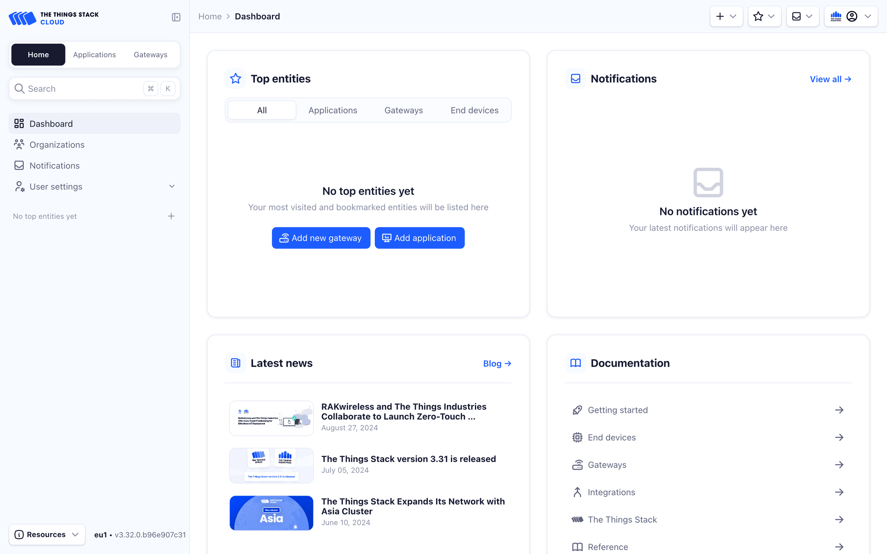

# Console

> The Console is the management application of The Things Stack for LoRaWAN. It is a web application which can be used to register applications, end devices or …

Source: https://www.thethingsindustries.com/docs/concepts/architecture/components/console/

The Console is the management application of The Things Stack for LoRaWAN. It is a web application which can be used to register applications, end devices or gateways, monitor network traffic, or configure network related options, among other things. The Console uses an OAuth access token to communicate with The Things Stack.

See the [Console Getting Started guide](https://www.thethingsindustries.com/docs/concepts/features/console/), for detailed instructions regarding the Console.

