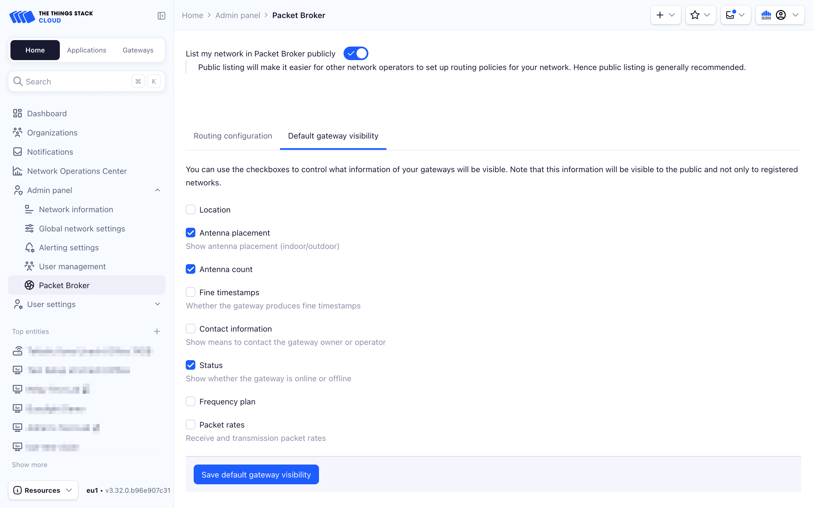

# Gateway Visibility Settings

> Gateway visibility configuration allows network administrators to configure who sees which gateway-related information. Having gateways listed publicly on the …

Source: https://www.thethingsindustries.com/docs/concepts/packet-broker/configure/gateway-visibilities/


Gateway visibility configuration allows network administrators to configure who sees which gateway-related information. Having gateways listed publicly on the map can help discovering partner networks, but it may also lead to privacy concerns. Therefore, Packet Broker allows configuring gateway visibility with fine-grained settings. [Learn more about gateway visibility](https://www.thethingsindustries.com/docs/concepts/packet-broker/#gateway-visibility-settings).

<!-- more -->

> **Note:** The Things Stack currently only allows configuring the default gateway visibility. Configuring visibility per Home Network is not yet supported.


## Configure Default Gateway Visibility

**Console:**

In the Packer Broker settings page, navigate to the **Default gateway visibility** tab to control what information of your gateways will be publicly visible.




**CLI:**

### Get Default Gateway Visibility

The default gateway visibility defines rules for all Home Networks if there is no specific gateway visibility for a Home Network.

Use the following command in your terminal to get the default routing policy:

```bash
ttn-lw-cli packetbroker home-networks gateway-visibilities get default
```

If there is no default gateway visibility defined, the above command fails with `not found`.

<details><summary>Example output</summary>

In the following example, all gateway visibility configuration fields are enabled:

```json
{
  "updated_at": "2021-09-27T09:55:56.326241Z",
  "visibility": {
    "location": true,
    "antenna_placement": true,
    "antenna_count": true,
    "fine_timestamps": true,
    "contact_info": true,
    "status": true,
    "frequency_plan": true,
    "packet_rates": true
  }
}
```

</details>

### Set Default Gateway Visibility

To set the default gateway visibility and enable all fields:

```bash
ttn-lw-cli packetbroker home-networks gateway-visibilities set default --all
```

To customize, see [Flags](#flags) below.

### Delete Default Gateway Visibility

To delete the default gateway visibility:

```bash
ttn-lw-cli packetbroker home-networks gateway-visibilities delete default
```

### Flags {#flags}

When setting gateway visibility, you can specify a combination of the following flags:

| Flag                    | Meaning                                                                |
| ----------------------- | ---------------------------------------------------------------------- |
| `--all`                 | Enable all fields                                                      |
| `--location`            | Enable gateway coordinates                                             |
| `--antenna-placement`   | Enable indoor/outdoor antenna placement                                |
| `--antenna-count`       | Enable number of antennas                                              |
| `--fine-timestamps`     | Enable whether the gateway produces fine timestamps                    |
| `--contact-information` | Enable administrative and technical contact information of the gateway |
| `--status`              | Enable online/offline status                                           |
| `--frequency-plan`      | Enable region and channel plan with frequencies that the gateway uses  |
| `--packet-rates`        | Enable receive and transmission packet rates                           |


