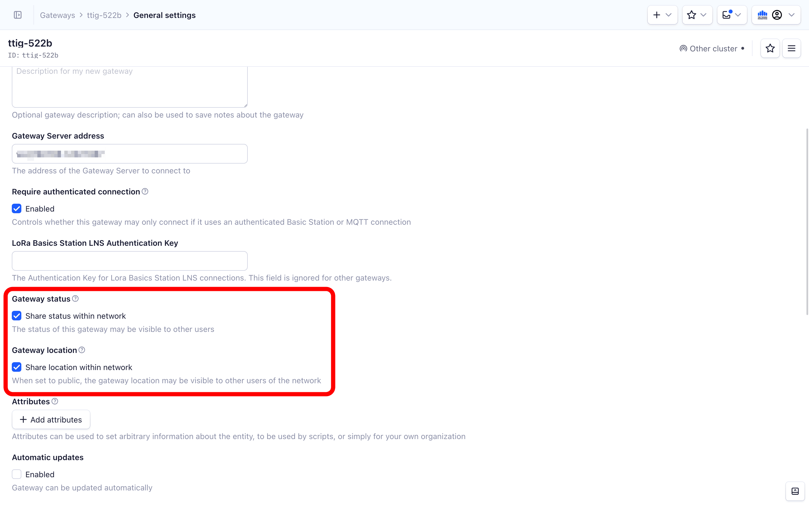

# Troubleshooting

> This section provides help for common issues and frequently asked questions you may have when using Packet Broker.

Source: https://www.thethingsindustries.com/docs/concepts/packet-broker/troubleshooting/


This section provides help for common issues and frequently asked questions you may have when using Packet Broker.

## My tenant is not receiving traffic from Packet Broker.

We recommend the following:

- Check if there are any incidents on the Packet Broker end. See [Packet Broker Status Page](https://www.thethingsindustries.com/docs/concepts/packet-broker/#status-page).
- Make sure your tenant is registered in Packet Broker. See [Configure Packet Broker section](https://www.thethingsindustries.com/docs/concepts/packet-broker/configure/).
- Double check if routing policies are properly configured. See [Routing Policies](https://www.thethingsindustries.com/docs/concepts/packet-broker/configure/routing-policies/).
- If you're sure that all previous points are checked, contact our [support](mailto:support@thethingsindustries.com).

## My gateway is not visible in the Packet Broker Mapper API.

For self-hosted deployments (The Things Stack Enterprise and Open Source), users need to configure the Packet Broker Mapper address in the [Packet Broker Agent](https://www.thethingsindustries.com/docs/concepts/packet-broker/connect/#configure-packet-broker-agent). Also, the Gateway Server needs to be configured to forward traffic to upstream hosts (see [Gateway Server Forwarding Options](https://www.thethingsindustries.com/docs/enterprise/management/configuration/gateway-server/#forwarding-options)).

Double check that your [Gateway Visibility Settings](https://www.thethingsindustries.com/docs/concepts/packet-broker/configure/gateway-visibilities/) are properly configured.

Your gateway's status and location have to be publicly available. To configure this in The Things Stack Console, navigate to the **General settings** tab in your gateway's overview page, and check the **Make status public** and **Make location public** boxes.




To set gateway status and location to public using the CLI, use the following commands:

```bash
ttn-lw-cli gateways set $GTW_ID --status-public --location-public
```

## I am unable to toggle the **Register network** button. What should I do?

The reason you cannot toggle the **Register network** button

