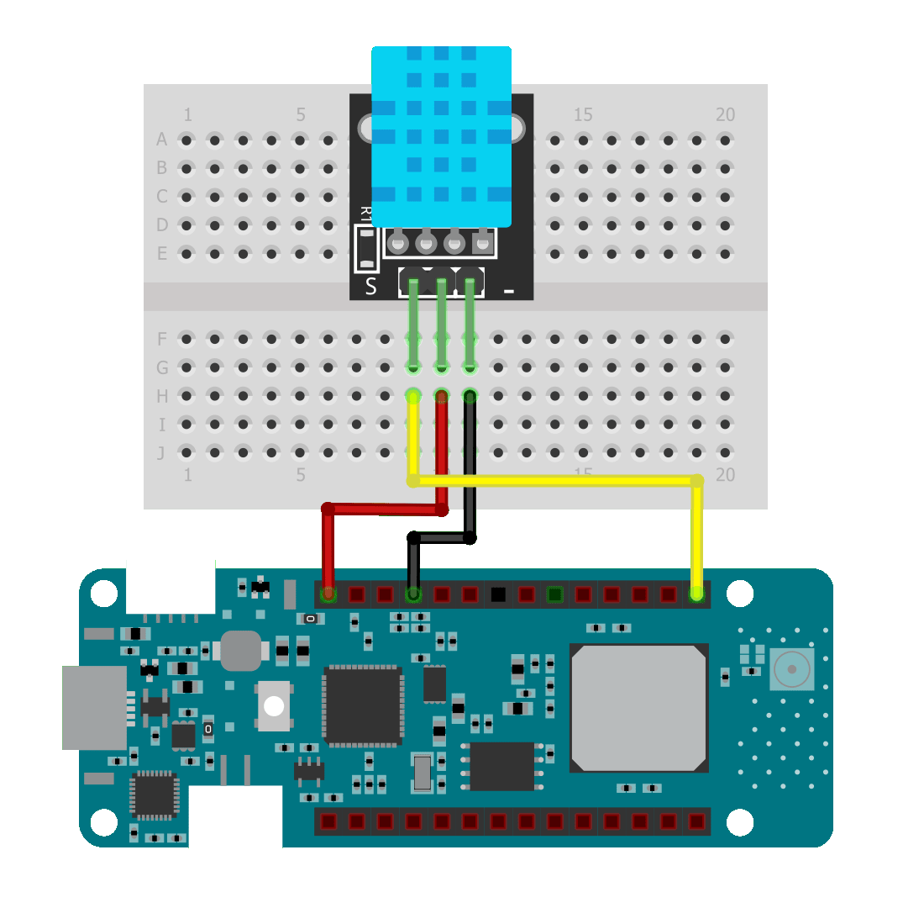
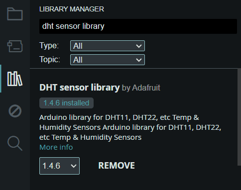
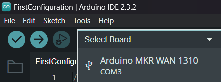
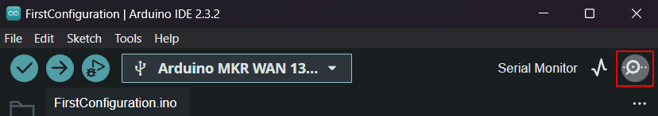
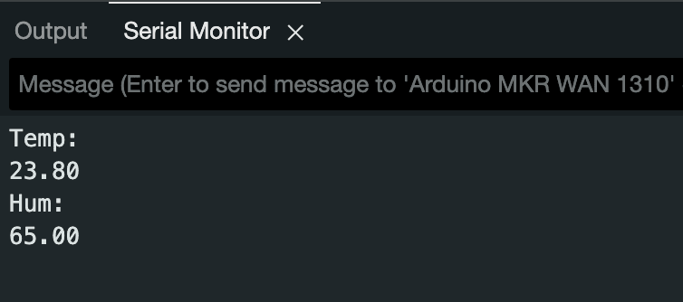
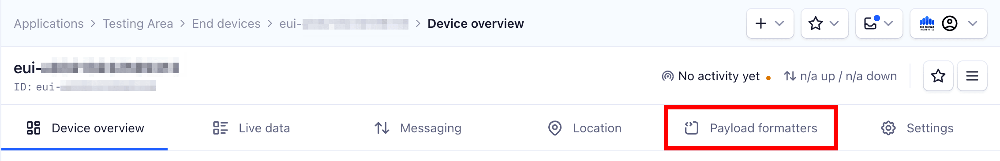
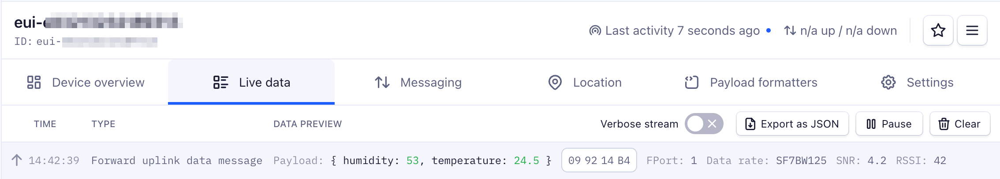

# Monitoring Temperature with MKR WAN 1310

> In this section we present an example project where we show how to connect a temperature and humidity sensor to the MKR WAN 1310 device to send the data to The …

Source: https://www.thethingsindustries.com/docs/hardware/devices/models/mkr1310/temp/


In this section we present an example project where we show how to connect a temperature and humidity sensor to the MKR WAN 1310 device to send the data to The Things Stack and decode it.

The sensor we are going to be using is a DHT11, which is a Temperature and Humidity sensor. For more information on how the sensor works and how the module you are using might differ in wiring, check [this guide](https://www.circuitbasics.com/how-to-set-up-the-dht11-humidity-sensor-on-an-arduino/).




## Building the Circuit

For this project you are going to be needing:
- DHT11 sensor
- Some jumper wires
- Breadboard

Once you have the components, wire it up like shown on the image on the right:
- **Arduino 5V** -> **Plus DHT11**
- **Arduino GND** -> **Minus DHT11**
- **Arduino Pin 6** -> **Signal DHT11**

> **Note:** Double check your own sensor's pinout, it can vary between modules. If you are using a bare DHT11, you might need to use a resistor.


## Programming the MKR 1310

Before we continue, you need to make sure you have the **DHT sensor library by Adafruit** installed in the Arduino IDE:  




Next is the code itself. You can find it below, but you do have to change a few things. Check the in-code comments for which those are.

```cpp
#include <MKRWAN.h>
#include <DHT.h>

LoRaModem modem(Serial1);

String appEui = ""; // Add your own AppEUI here
String appKey = ""; // Add your own AppKey here

DHT dht(6, DHT11);

void setup() {
  Serial.begin(115200);
  while (!Serial);
  // change this to your regional band (eg. US915, AS923, ...)
  if (!modem.begin(EU868)) {
    Serial.println("Failed to start module");
    while (1) {}
  };
  
  dht.begin();

  int connected = modem.joinOTAA(appEui, appKey);
  if (!connected) {
    Serial.println("Something went wrong; are you indoor? Move near a window and retry");
    while (1) {}
  }
}

void loop() {
  int t = dht.readTemperature() * 100;
  int h = dht.readHumidity() * 100;

  byte payload[4];
  payload[0] = highByte(t);
  payload[1] = lowByte(t);
  payload[2] = highByte(h);
  payload[3] = lowByte(h);

  Serial.println("Temperature: ");
  Serial.println(dht.readTemperature());
  Serial.println("Humidity: ");
  Serial.println(dht.readHumidity());

  modem.beginPacket();
  modem.write(payload, sizeof(payload));
  modem.endPacket(true);
  delay(100000);
}
```

Now the code needs to be uploaded to the MKR WAN 1310. First plug the Arduino into your computer. In the IDE, click on **Select Board** at the top, and select your **Arduino MKR WAN 1310**.  




Once that is done you can upload the file to the board (Using the **->** button). Once the code is uploaded successfully, open the Serial Monitor. You can open it by clicking the **icon in the top-right corner**.




Temperature and humidity values should be listed in the Serial Monitor.  




> **Note:** If the Arduino IDE Serial Monitor does not show DHT sensor data, make sure to double-check the wiring.


## Decoding Temperature and Humidity data

Now that the device is working go back to The Things Stack and set up the payload formatter. A payload formatter will turn the hexadecimal string received into readable text. To do this, in your application on The Things Stack, click on **Payload formatters**.




Select the **Custom Javascript formatter** from the **Formatter type** dropdown.  

Now paste the following code in the **Formatter code** field:  
```js
function decodeUplink(input) {
  // Read the temperature and humidity from the payload
  var t = (input.bytes[0] << 8 | input.bytes[1]) / 100;
  var h = (input.bytes[2] << 8 | input.bytes[3]) / 100; 
  
  return {
    data: {
      temperature: t,
      humidity: h
    }
  };
}
```

If you go back to the **Live Data** tab you'll see the readable temperature and humidity values showing up!  




This concludes our example project. Now you can proceed with creating your own project! Make sure to check our [integrations](https://www.thethingsindustries.com/docs/integrations/) that can help you visualize your data, set up monitoring and alerting, etc.  
