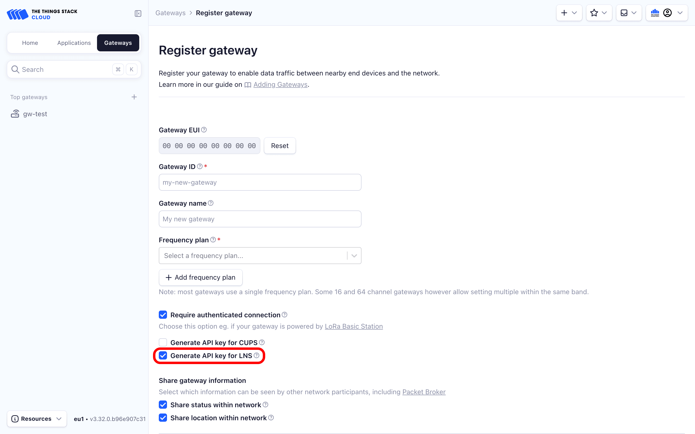
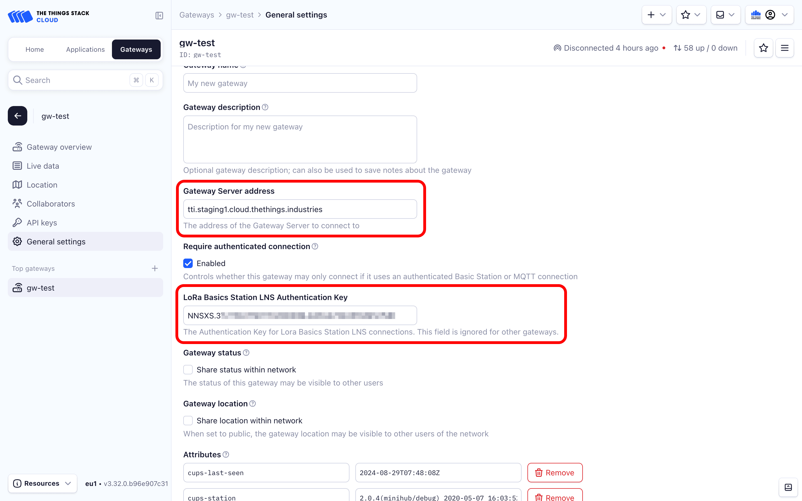

# Using CUPS to redirect to a different LNS

> This section explains how redirect your gateway from one The Things Stack instance to another using CUPS, thus facilitating remote gateway management.

Source: https://www.thethingsindustries.com/docs/hardware/gateways/concepts/lora-basics-station/cups-forwarding/

This section explains how redirect your gateway from one The Things Stack instance to another using CUPS, thus facilitating remote gateway management.

If your gateway is using [CUPS](https://www.thethingsindustries.com/docs/hardware/gateways/concepts/lora-basics-station/cups/) to connect to The Things Stack, and you want to redirect it from one The Things Stack instance to another, just follow the steps below. As an example, we consider redirecting a gateway from The Things Stack Sandbox to The Things Stack Cloud.

First, register your gateway in the target instance (The Things Stack Cloud in our example). You can choose to **Generate API key for LNS** upon registering, or to follow steps to create an [LNS key](https://www.thethingsindustries.com/docs/hardware/gateways/concepts/lora-basics-station/cups/#create-separate-cups-and-lns-api-keys) (gateway API key with linking rights) in the target instance after registering.

Copy the LNS key from the target instance (that you created in previous step). In the source instance (The Things Stack Sandbox in our example), navigate to your gateway's **General settings** tab and paste the LNS key you've copied in the **LoRa Basics Station LNS Authentication Key** field.

Navigate to your gateway's **General settings** tab in the target instance, copy the **Gateway Server address** and paste it in the **Gateway Server address** field of the source instance.

You can optionally invalidate the old LNS key in the source instance, either by deleting it or by removing the linking right.

Upon the next CUPS request, the gateway will connect to the target The Things Stack instance and stop sending packets to the source instance. Usually, a CUPS request is sent every 24h, but in this case, it will happen sooner. Changing the Gateway Server address forces the gateway to reconnect in about 10 minutes on average. Also, invalidating the old LNS key in the source instance results in CUPS lookup being done before the 24h window finishes, during which the gateway will redirect to the target instance.

