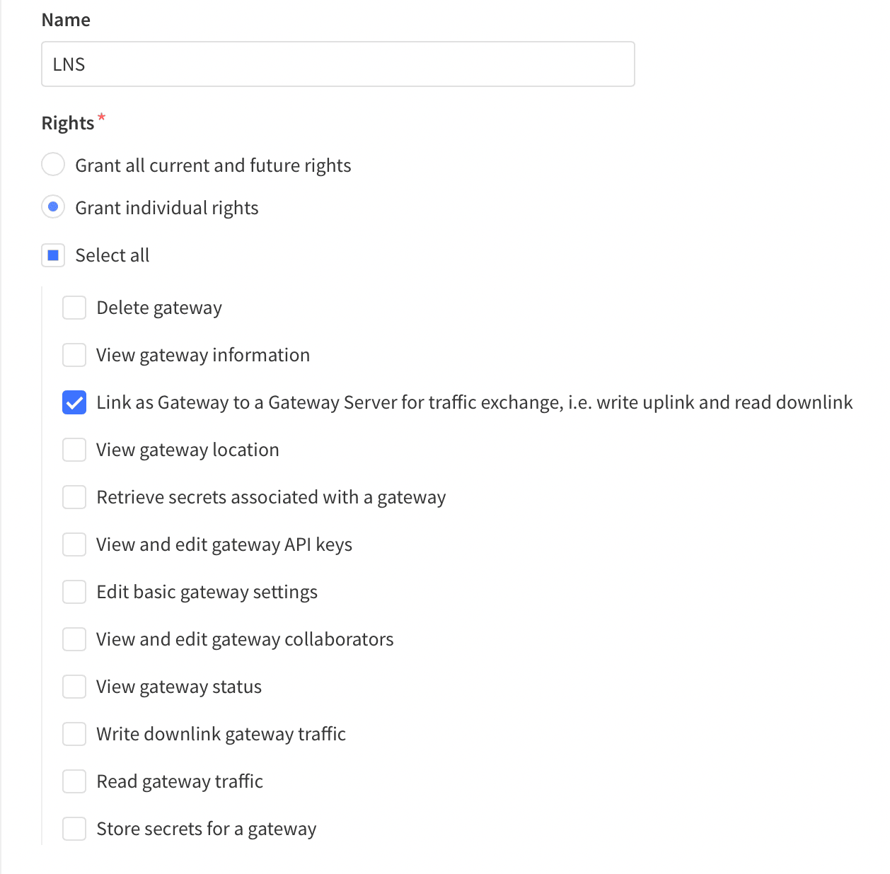

# LoRaWAN Network Server (LNS)

> LNS establishes a data connection between a LoRa Basics™ Station and The Things Stack. This page contains information about connecting your gateway to The …

Source: https://www.thethingsindustries.com/docs/hardware/gateways/concepts/lora-basics-station/lns/


LNS establishes a data connection between a LoRa Basics™ Station and The Things Stack. This page contains information about connecting your gateway to The Things Stack using the LoRaWAN® Network Server
 (LNS) protocol.

These are general instructions for all LoRa Basics™ Station gateways. For specific instructions for connecting your gateway via LNS, look in the [Gateways](https://www.thethingsindustries.com/docs/hardware/gateways/) section.

> **Note:** The LNS protocol is **required** for sending and receiving LoRaWAN® data with LoRa Basics™ Station, while the CUPS protocol is not. However, configuring CUPS will automatically retrieve LNS credentials and configure LNS on your gateway, so there is no need to configure both.


## Requirements

1. User account on The Things Stack with rights to create gateways.
2. A gateway which support LoRa Basics™ Station.

## Create a Gateway

To connect a gateway using the LNS protocol, you must first add the gateway in The Things Stack. This can be done either in the console, or via the command line. See instructions for [Adding Gateways](https://www.thethingsindustries.com/docs/hardware/gateways/concepts/adding-gateways/).

## Create an API Key

LNS requires an API Key with the following rights:

- Link as Gateway to a Gateway Server for traffic exchange, i.e. write uplink and read downlink




To create this API key for your gateway, follow instructions for [Creating a Gateway API key ](https://www.thethingsindustries.com/docs/hardware/gateways/concepts/adding-gateways/#create-gateway-api-key).

## Configure Gateway

All LoRa Basics™ Station gateways support the following configuration options. Consult your gateway documentation for more information about configuring your specific gateway.

### LNS Server Address

The server address is the network endpoint of The Things Stack LNS. It is a combination of the **protocol** (wss), the **server address**, and the **port**.

Enter the following in your gateway as the LNS Server Address: `wss://<server-address>:8887`.

The `<server-address>` is the address of your The Things Stack deployment. See [Server Addresses](https://www.thethingsindustries.com/docs/concepts/server-addresses/) for more info.

### LNS Server Certificate / LNS Trust

This is the [CA certificate](https://en.wikipedia.org/wiki/Certificate_authority) which secures your domain. A `.pem` file containing common certificates is available in the [Root Certificates Reference](https://www.thethingsindustries.com/docs/concepts/advanced/root-certificates/).

Upload the `.pem` file in your gateway as the LNS Server Certificate, i.e. LNS Trust.

### LNS Key File

This is a file which The Things Stack uses to verify the identity of your gateway.

Instructions below show how to create a file called `lns.key`, replacing `"your-lns-api-key"` with the [LNS API key](https://www.thethingsindustries.com/docs/hardware/gateways/concepts/lora-basics-station/lns/#create-an-api-key) you created above.

On Linux or macOS use the following commands:

```bash
LNS_KEY="your-lns-api-key"
echo "Authorization: Bearer $LNS_KEY" | perl -p -e 's/\r\n|\n|\r/\r\n/g'  > lns.key
```

On Windows, you can use Command Prompt:

```bash
set LNS_KEY=your-lns-api-key
echo Authorization: Bearer %LNS_KEY% > lns.key
```

or PowerShell:

```powershell
$env:LNS_KEY='your-lns-api-key'
write-output "Authorization: Bearer $env:LNS_KEY" | set-content lns.key
```

The commands above create a file called `lns.key`, terminated with a Carriage Return Line Feed (`0x0D0A`) character. Upload this file in your gateway as the LNS key.

