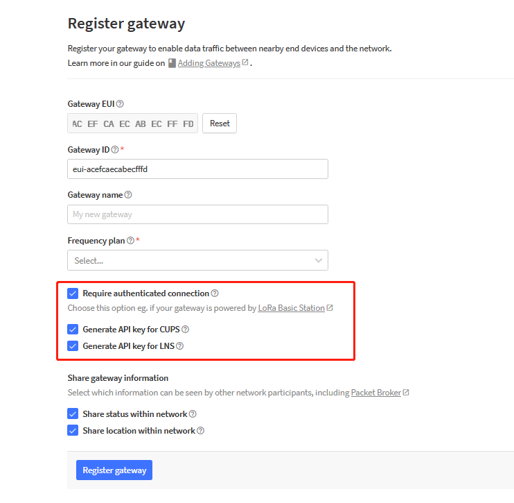
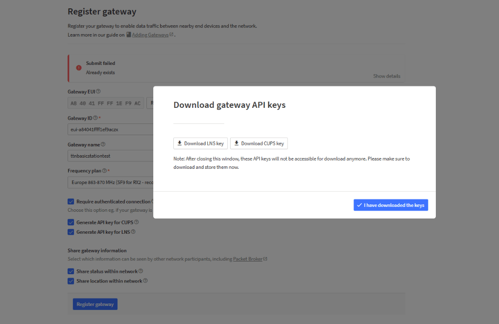
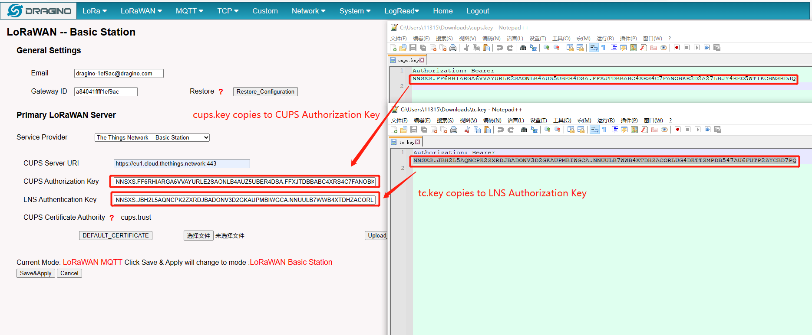
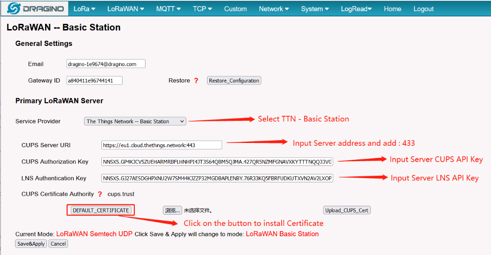
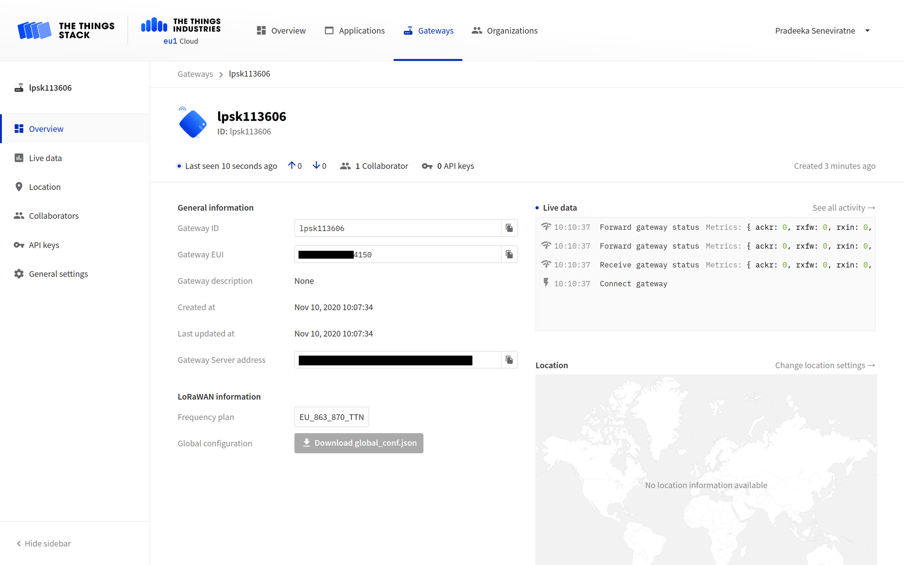
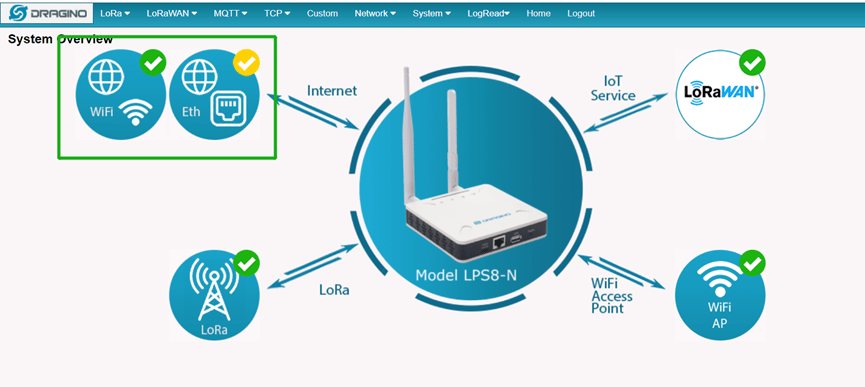

# Connect Dragino LPS8N with Lora Basics™ Station

> This section contains instructions for connecting the Dragino LPS8N LoRaWAN® gateway to The Things Stack using LoRa Basics™ Station.

Source: https://www.thethingsindustries.com/docs/hardware/gateways/models/dragino-lps8/lbs/

This section contains instructions for connecting the Dragino LPS8N LoRaWAN® gateway to The Things Stack using [LoRa Basics™ Station](https://www.thethingsindustries.com/docs/hardware/gateways/concepts/lora-basics-station/).

## Registering Gateway

In the The Things Stack console, go to the **Gateways** tab and click the **Register Gateway** button to register the gateway and make sure to select these three settings below:

When the keys popup shows after registering, download the keys, and click **I have downloaded the keys**.

> **Note:** If you have already registered your gateway and forgot to check the boxes, or if you have been using UDP and want to switch to LoRa Basics™ Station, [create API keys manually](https://www.thethingsindustries.com/docs/gateways/concepts/lora-basics-station/cups/#create-separate-cups-and-lns-api-keys).

### Configuring Gateway

In the Gateway's Web UI, navigate to **LoRaWAN > LoRaWAN** in the top menu.

On this page, configure the following settings:

- **Service Provider**: `The Things Network -- Basic Station`
- **CUPS Server URI**: The Things Stack server address with port 443 (e.g. `https://eu1.cloud.thethings.network:443`)
- **CUPS Authorization Key**: The CUPS key you just downloaded.
- **LNS Authorization Key**: The LNS key you just downloaded.
- **CUPS Certificate Authority**: Install a certificate by clicking on the `DEFAULT_CERTIFICATE` button.

**Note**: When entering the keys, the **"Authorization: Bearer"** field should not be entered in the TTN Basics Station configuration of the gateway.

Once you've done all that, click **Save & Apply**.

Finally, test your connection by going to the LPS8N's **Overview** page. You should see the gateway status changed to **connected** (indicated by a blue dot) or observe the frequently updating **Last seen** time. Also, see the **Live data** section for various gateway related activities.

You can also verify the presence of a green tick on the LoRa icon in the Web UI.

