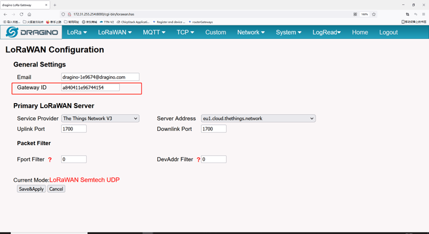
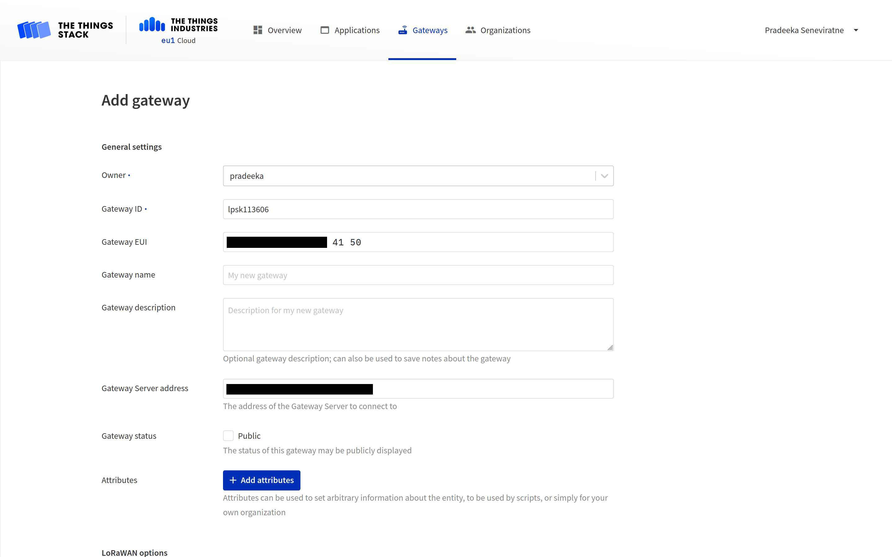
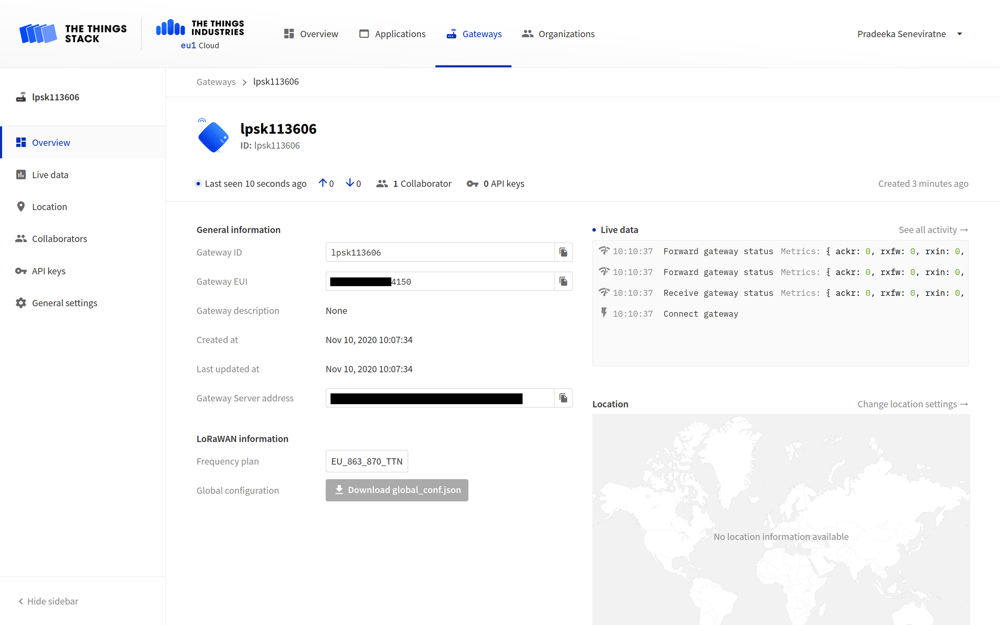
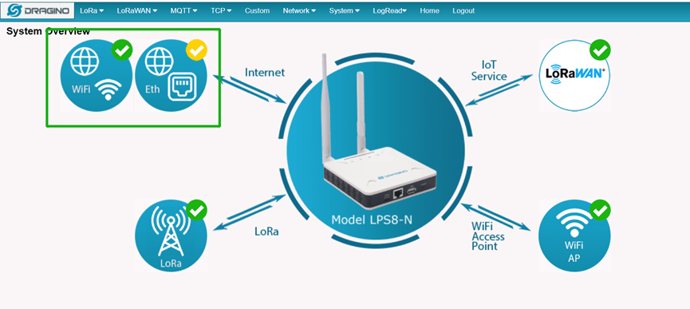

# Connect Dragino LPS8N with UDP Packet Forwarder

> This section contains instructions for connecting the Dragino LPS8N LoRaWAN® gateway to The Things Stack using the Semtech UDP Packet Forwarder.

Source: https://www.thethingsindustries.com/docs/hardware/gateways/models/dragino-lps8/udp/

This section contains instructions for connecting the Dragino LPS8N LoRaWAN® gateway to The Things Stack using the [Semtech UDP Packet Forwarder](https://www.thethingsindustries.com/docs/hardware/gateways/concepts/udp/).

On the Web UI, navigate to **LoRaWAN > LoRaWAN** in the menu.

On the LoRaWAN Configuration page, configure the following settings:

1. **Service Provider**: `The Things Network V3`
2. **Server Address**: The Things Stack server address (e.g. `eu1.cloud.thethings.network`)
3. **Gateway ID**: This is the default Gateway EUI for LPS8N. You can keep it as is.
4. **Uplink Port**: `1700`
5. **Downlink Port**: `1700`

Copy the **Gateway ID** which you will need in the next step.
> **Note:** The LPS8N Gateway ID is equivalent to {} Gateway EUI.

Select **Save & Apply**.

## Adding LPS8N to The Things Stack

You can add the LPS8N gateway to The Things Stack by following the instructions on the [ Adding Gateways](https://www.thethingsindustries.com/docs/hardware/gateways/concepts/adding-gateways/) page. Use the **Gateway ID** value that you previously copied for the **Gateway EUI** field.

Finally, test your connection by going to the LPS8N's **Overview** page. You should see the gateway status changed to **connected** (indicated by a blue dot) or observe the frequently updating **Last seen** time. Also, see the **Live data** section for various gateway related activities.

You can also verify the presence of a green tick on the LoRa icon in the Web UI.

