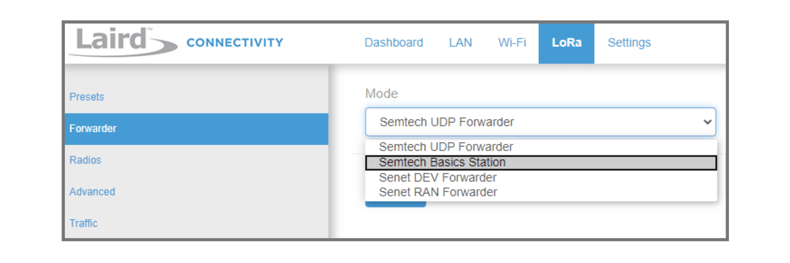
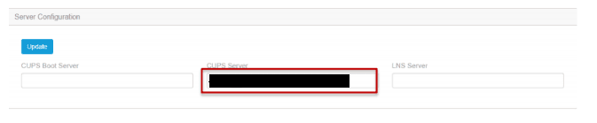
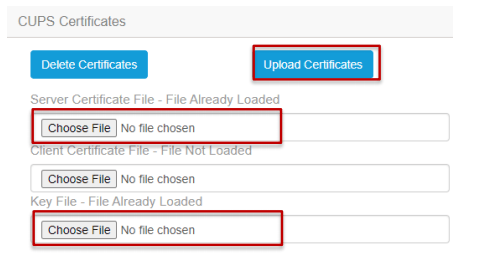
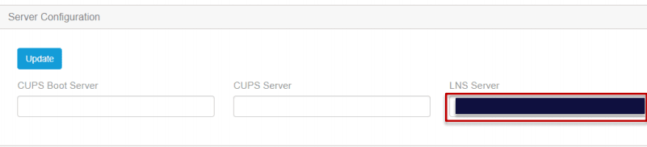
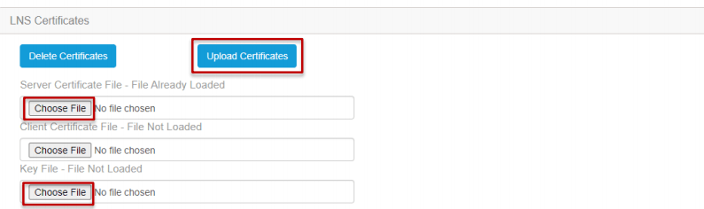

# Connect Laird Sentrius™ RG1xx with LoRa Basics™ Station

> This section contains instructions for connecting to The Things Stack using LoRa Basics™ Station.

Source: https://www.thethingsindustries.com/docs/hardware/gateways/models/laird-sentrius/lbs/

This section contains instructions for connecting to The Things Stack using [LoRa Basics™ Station](https://www.thethingsindustries.com/docs/hardware/gateways/concepts/lora-basics-station/).

To set up LoRa packet forwarding on the gateway, follow these steps.

Click the **LoRa** tab in the main menu.

Click on the **Forwarder** tab.

Choose **Semtech Basic Station** as the **Mode**.

## CUPS

To connect the gateway via CUPS protocol, follow the instructions for [Connecting CUPS](https://www.thethingsindustries.com/docs/hardware/gateways/concepts/lora-basics-station/cups/).

Fill the **CUPS Server** in the **Server Configuration** with the [CUPS Server Address](https://www.thethingsindustries.com/docs/hardware/gateways/concepts/lora-basics-station/cups/#cups-server-address).

Click on the **Choose File** button to upload the **Server Certificate File** and **key File** with the [CUPS Server Certificate](https://www.thethingsindustries.com/docs/hardware/gateways/concepts/lora-basics-station/cups/#cups-server-certificate--cups-trust) and [CUPS Key File](https://www.thethingsindustries.com/docs/hardware/gateways/concepts/lora-basics-station/cups/#cups-key-file) respectively.

Click on the **Upload Certificates** button.

Click **Update**. If your configuration was successful, your gateway will connect to The Things Stack after a couple of seconds.

## LNS

To connect the gateway via LNS protocol, follow the instructions for [Connecting LNS](https://www.thethingsindustries.com/docs/hardware/gateways/concepts/lora-basics-station/lns/).

Fill the **LNS Server** in the **Server Configuration** with the [LNS Server Address](https://www.thethingsindustries.com/docs/hardware/gateways/concepts/lora-basics-station/lns/#lns-server-address).

Click on the **Choose File** button to upload the **Server Certificate File** and **key File** with the [LNS Server Certificate](https://www.thethingsindustries.com/docs/hardware/gateways/concepts/lora-basics-station/lns/#lns-server-certificate--lns-trust) and [LNS Key File](https://www.thethingsindustries.com/docs/hardware/gateways/concepts/lora-basics-station/lns/#lns-key-file) respectively.

Click on the **Upload Certificates** button.

Click **Update**. If your configuration was successful, your gateway will connect to The Things Stack after a couple of seconds.

