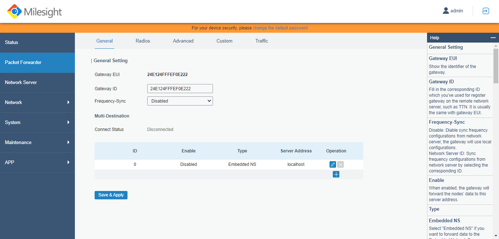
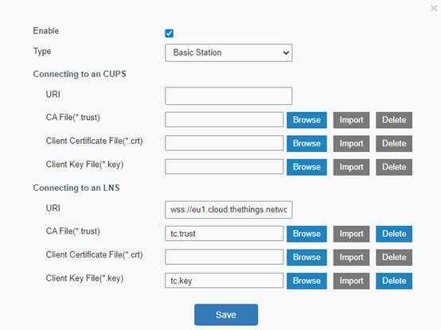

# Connect Milesight UG56 with Lora Basics™ Station

> This section contains instructions for connecting the Milesight UG56 LoRaWAN® gateway to The Things Stack using LoRa Basics™ Station.

Source: https://www.thethingsindustries.com/docs/hardware/gateways/models/milesightug56/lbs/

This section contains instructions for connecting the Milesight UG56 LoRaWAN® gateway to The Things Stack using [LoRa Basics™ Station](https://www.thethingsindustries.com/docs/hardware/gateways/concepts/lora-basics-station/).

In the **Packet Forwarder** menu and **General** tab, click the little **+** button to create a new server.

In the server configuration options, check the **Enable** box. Choose **Basic Station** as the **Type**.

Follow the instructions for [Connecting LNS](https://www.thethingsindustries.com/docs/hardware/gateways/concepts/lora-basics-station/lns/). If using CUPS, following the instructions for [Connecting CUPS](https://www.thethingsindustries.com/docs/hardware/gateways/concepts/lora-basics-station/cups/).

Click **Save** to continue.

If your configuration was successful, your gateway will connect to The Things Stack after a couple of seconds.

