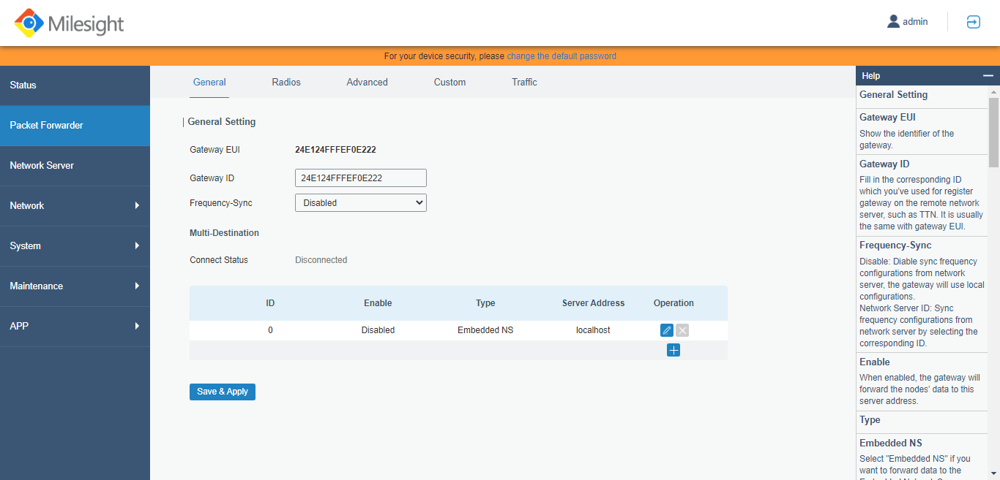
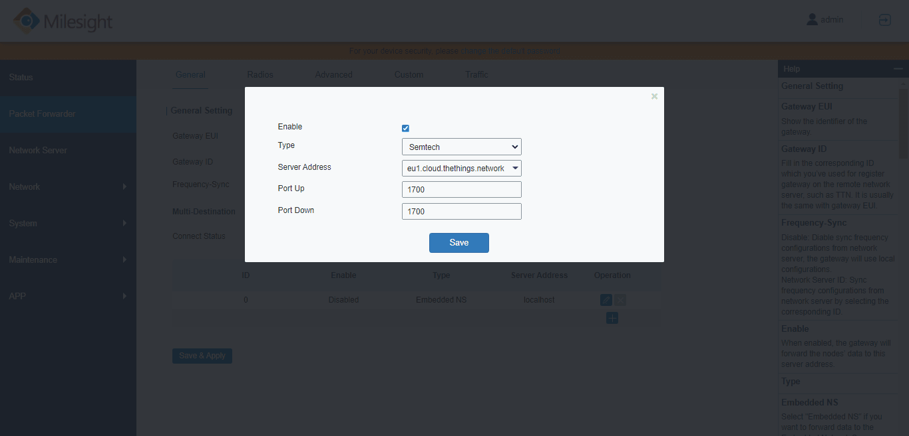

# Connect Milesight UG87 with UDP Packet Forwarder

> This section contains instructions for connecting the Milesight UG87 LoRaWAN® gateway to The Things Stack using the Semtech UDP Packet Forwarder.

Source: https://www.thethingsindustries.com/docs/hardware/gateways/models/milesightug87/packet-forwarder/

This section contains instructions for connecting the Milesight UG87 LoRaWAN® gateway to The Things Stack using the [Semtech UDP Packet Forwarder](https://www.thethingsindustries.com/docs/hardware/gateways/concepts/udp/).

In the **Packet Forwarder** menu and **General** tab, click the little **+** button to create a new server.

In the server configuration options, check the **Enable** box.

Choose **Semtech** as the **Type**.

For the **Server Address** choose **custom**, and enter the address of The Things Stack deployment you are using. See [Server Addresses](https://www.thethingsindustries.com/docs/concepts/server-addresses/) section for help.

Choose the appropriate **Port Up** and **Port Down** values. These are both **1700** by default in The Things Stack.

Click **Save** to continue.

If your configuration was successful, your gateway will connect to The Things Stack after a couple of seconds.

