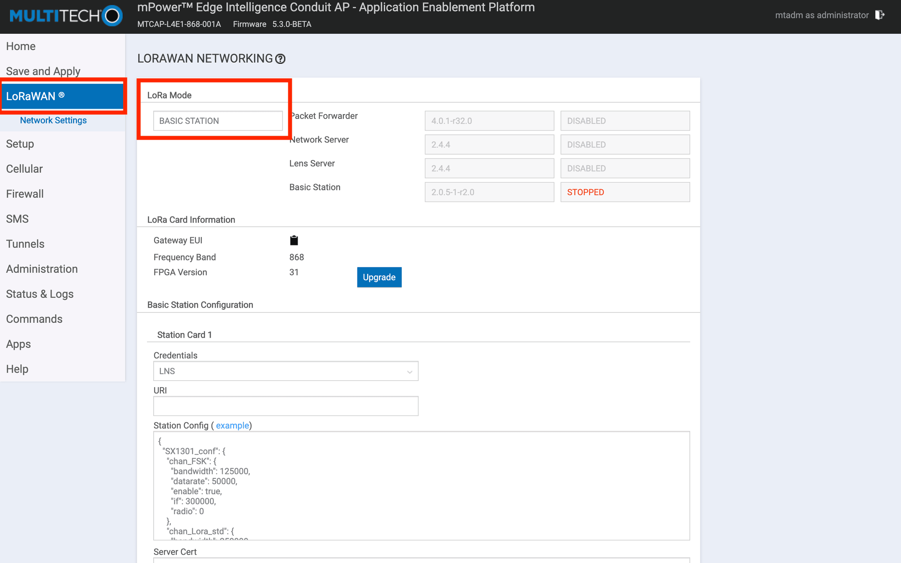
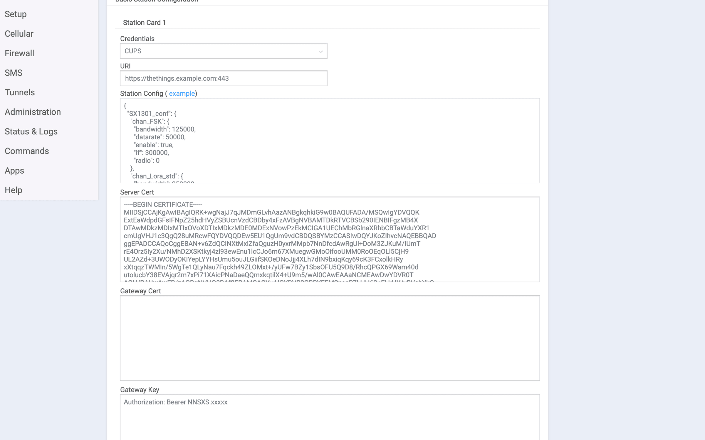
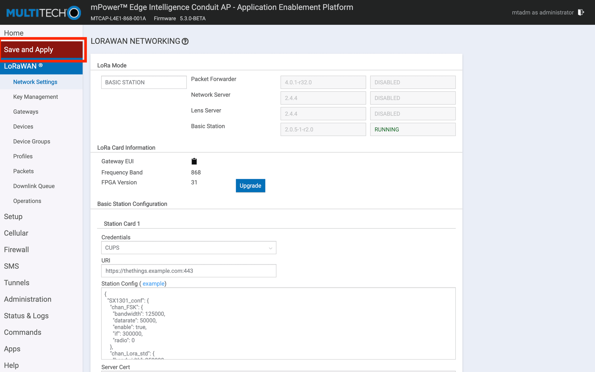

# Connect Multitech Conduit with LoRa Basics™ Station

> This section contains instructions for connecting the Multitech Conduit AEP to The Things Stack using LoRa Basics™ Station.

Source: https://www.thethingsindustries.com/docs/hardware/gateways/models/multitechconduit/lbs/

This section contains instructions for connecting the Multitech Conduit AEP to The Things Stack using [LoRa Basics™ Station](https://www.thethingsindustries.com/docs/hardware/gateways/concepts/lora-basics-station/).

## Prerequisites

1. Multitech Conduit AEP gateway running [mPower 5.3.0 firmware or later](http://www.multitech.net/developer/downloads/).
2. Hardware required: MTCDT with `MTAC-LORA-H mCard`

> **Warning:** LoRa Basics™ Station is not supported on Multitech Conduit gateways with [**MTAC-LORA-1.0**](http://www.multitech.net/developer/software/lora/running-basic-station-on-conduit/) USB cards. Please follow instructions for connecting with the [Semtech UDP Packet Forwarder](https://www.thethingsindustries.com/docs/hardware/gateways/models/multitechconduit/udp/)

To set up LoRa packet forwarding on the gateway, follow these steps.

Click the **LoRaWAN** tab in the left menu.

Choose **Basic Station** in the **LoRa Mode** dropdown.

On Multitech gateways, only CUPS **or** LNS can be configured. Configuring CUPS will automatically configure LNS, so to use The Things Stack, just follow the instructions for [Connecting CUPS](https://www.thethingsindustries.com/docs/hardware/gateways/concepts/lora-basics-station/cups/).

Be sure to select **CUPS** in the **Credentials** dropdown.

The entire configuration should look like:

- Credentials: CUPS
- URI: See [Server Addresses](https://www.thethingsindustries.com/docs/concepts/server-addresses/)
- Station Config: Leave it as-is (will be overwritten by CUPS)
- Server Cert: Use the [ISRG Root X1 Certificate](https://www.thethingsindustries.com/docs/concepts/advanced/root-certificates/#isrg-root-x1)
- Gateway Cert: Leave blank
- Gateway Key: [Create a CUPS API key](https://www.thethingsindustries.com/docs/hardware/gateways/concepts/lora-basics-station/cups/#create-separate-cups-and-lns-api-keys). Copy the API key and paste it to this field in the following format: `Authorization: Bearer <cups-api-key>`. Be sure you have also configured CUPS to [transmit an LNS API Key](https://www.thethingsindustries.com/docs/hardware/gateways/concepts/lora-basics-station/cups/#configure-cups-to-send-the-lns-api-key).

After entering the CUPS configuration, click the **Submit** button, and then click **Save and Apply**. The gateway will apply the changes.

If your configuration was successful, your gateway will connect to The Things Stack after a couple of seconds.

