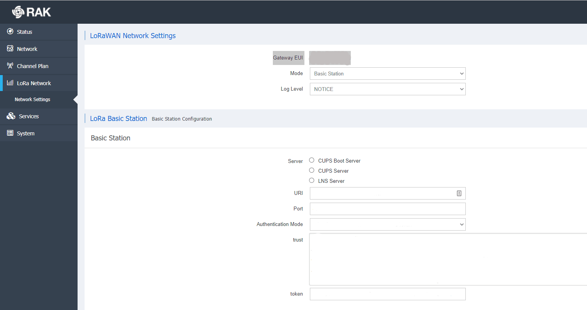

# Connect RAK7240 in Basic Station Mode

> RAK7240’s Basic Station mode utilizes the LoRa Basics™ Station protocol. As part of the Basic Station mode, RAK7240 supports two LoRa Basics™ Station …

Source: https://www.thethingsindustries.com/docs/hardware/gateways/models/rak-7240/bs/

RAK7240's **Basic Station** mode utilizes the [LoRa Basics™ Station](https://www.thethingsindustries.com/docs/hardware/gateways/concepts/lora-basics-station/) protocol. As part of the Basic Station mode, RAK7240 supports two LoRa Basics™ Station subprotocols - [LNS](https://www.thethingsindustries.com/docs/hardware/gateways/concepts/lora-basics-station/lns/) and [CUPS](https://www.thethingsindustries.com/docs/hardware/gateways/concepts/lora-basics-station/cups/). Follow this section to learn how to connect to The Things Stack Network Server using this mode.

To configure the gateway to use LNS or CUPS, first navigate to **LoRa Network &#8594; Network Settings &#8594; LoRa Basic Station**.

## CUPS

To connect the gateway to via CUPS protocol, follow the instructions for [Connecting CUPS](https://www.thethingsindustries.com/docs/hardware/gateways/concepts/lora-basics-station/cups/).

Select **TLS Server Authentication and Client Token** for the **Authentication Mode**. Copy your CUPS Server Certificate and paste it in the **trust** field. Copy the [CUPS Key File](https://www.thethingsindustries.com/docs/hardware/gateways/concepts/lora-basics-station/cups/#cups-key-file) and paste it in the **token** field.

## LNS

To connect the gateway to via LNS protocol, fill in the info in the **LNS Server** section instead.

Follow the instructions for [Connecting LNS](https://www.thethingsindustries.com/docs/hardware/gateways/concepts/lora-basics-station/lns/).

Select **TLS Server Authentication and Client Token** for the **Authentication Mode**. Copy your LNS Server Certificate and paste it in the **trust** field. Copy the [LNS Key File](https://www.thethingsindustries.com/docs/hardware/gateways/concepts/lora-basics-station/lns/#lns-key-file) and paste it in the **token** field.

Whichever subprotocol you have configured, press **Save & Apply** and your gateway should appear as connected in The Things Stack Console.

