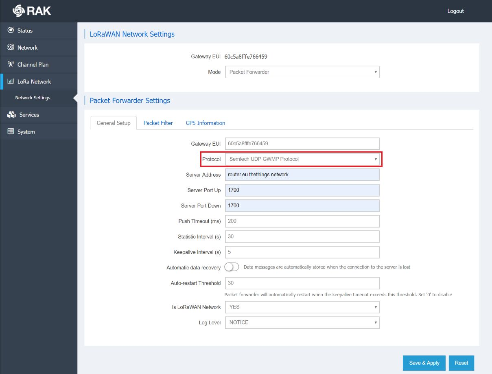

# Connect RAK7240 in Packet Forwarder Mode

> RAK7240’s Packet Forwarder mode utilizes the Semtech UDP Packet Forwarder protocol. Follow this section to learn how to connect to The Things Stack Network …

Source: https://www.thethingsindustries.com/docs/hardware/gateways/models/rak-7240/pf/

RAK7240's **Packet Forwarder** mode utilizes the [Semtech UDP Packet Forwarder](https://www.thethingsindustries.com/docs/hardware/gateways/concepts/udp/) protocol. Follow this section to learn how to connect to The Things Stack Network Server using this mode.

> **Note:** Packet Forwarder mode also includes an option to use the gateway as an MQTT bridge. This allows RAK7240 to connect to its built-in LoRa Network Server, or to an external server. However, The Things Stack is not supported (yet) as an external LoRaWAN® network server by this gateway.

To configure the gateway to use the Semtech UDP Packet Forwarder, navigate to **LoRa Network &#8594; Network Settings &#8594; Packet Forwarder Settings**.

## Semtech UDP GWMP Protocol

To use the legacy Semtech UDP Packet Forwarder, select **Semtech UDP GWMP Protocol** in the **Protocol** drop-down list.

Enter The Things Stack address in the **Server Address** field.

Fill in the **Server Port Up** and **Server Port Down** fields with value `1700`.

Other settings can retain their default values. For more information about these parameters, please visit the [Packet Forwarder mode documentation](https://docs.rakwireless.com/Knowledge-Hub/Learn/WEB-Management-Platform/#packet-forwarder).

