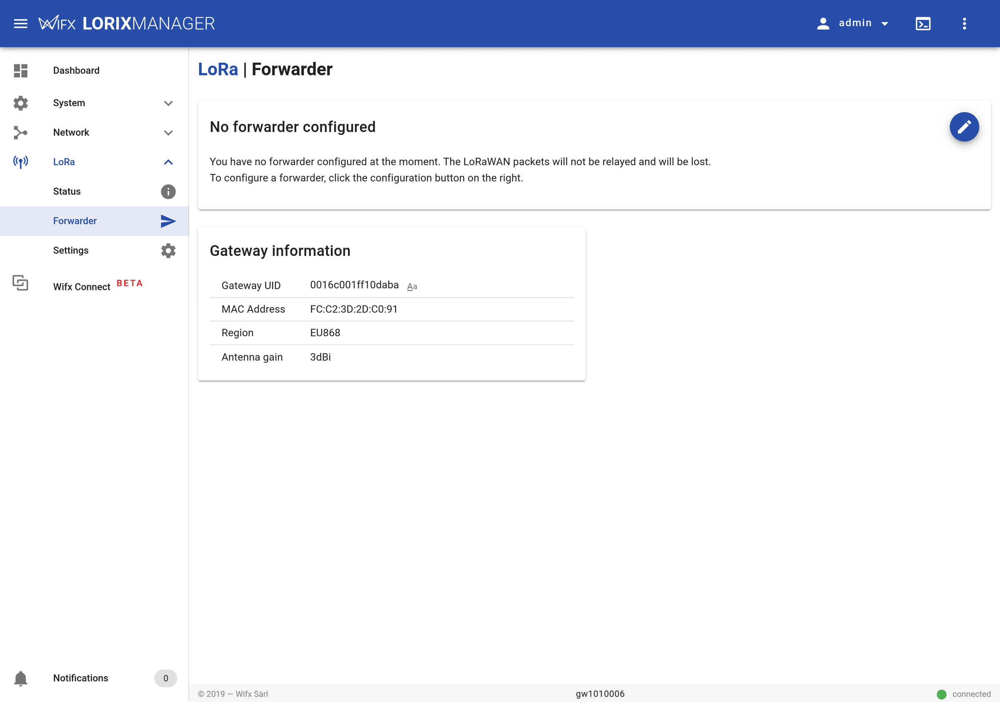
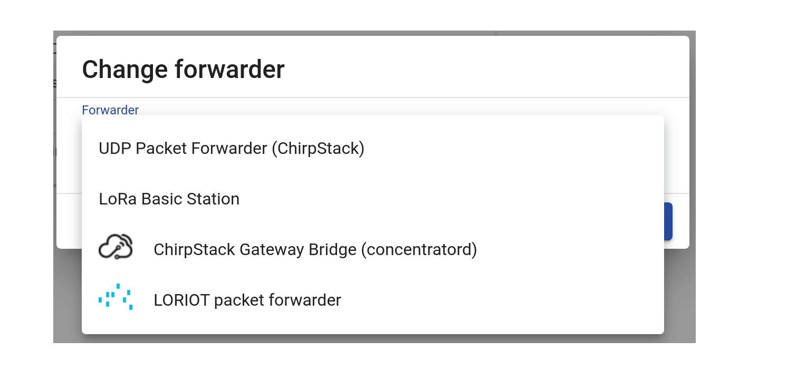
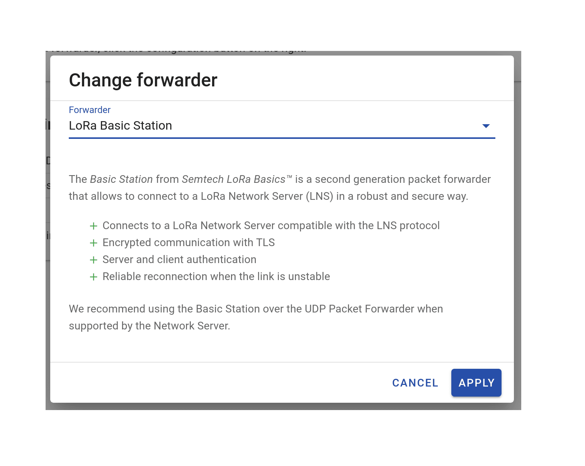
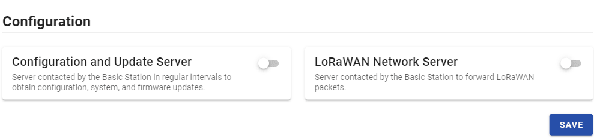
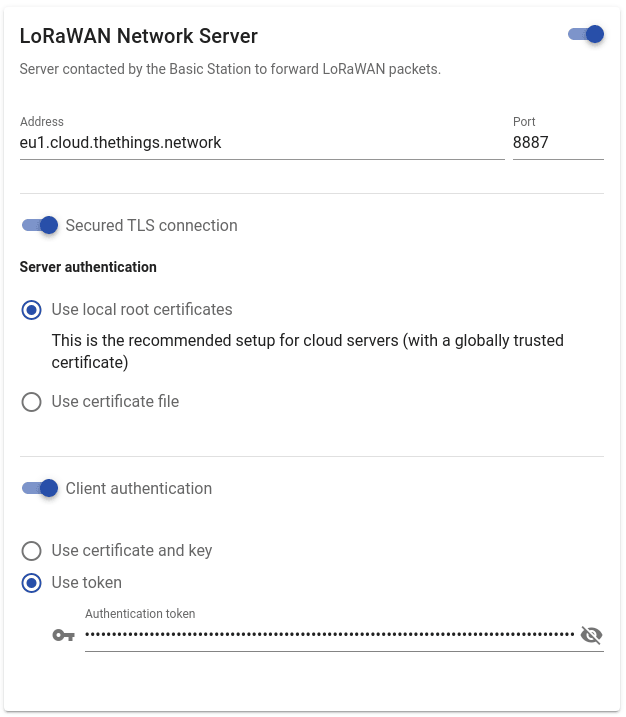
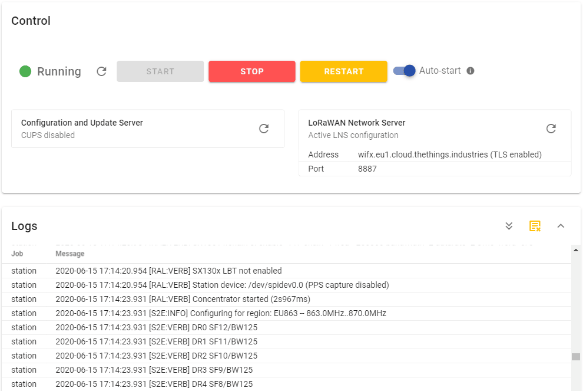

# Connect LORIX One with Lora Basics™ Station

> This section contains instructions for connecting to The Things Stack using LoRa Basics™ Station.

Source: https://www.thethingsindustries.com/docs/hardware/gateways/models/wifx-lorix-one/lbs/


This section contains instructions for connecting to The Things Stack using [LoRa Basics™ Station](https://www.thethingsindustries.com/docs/hardware/gateways/concepts/lora-basics-station/).

## Enable the Basic Station

Go to the **LoRa > Forwarder** page.




On the top right, click the **Edit** button to choose a forwarder.




In the list, select **LoRa Basic Station** and press apply.




## Configure the LNS

Scroll down to the **Configuration** section and enable the **LoRaWAN Network Server** option.




Configure the **Address** with the [Server Address](https://www.thethingsindustries.com/docs/concepts/server-addresses/) of your deployment, and **Port** with LNS port `8887`.

Enable the **Secured TLS connection** and select the **Use local root certificates** option. If you need to use a certificate specific to your infrastructure (for on-premise installations), use the **Use certificate file** option instead and upload the certificate.

Enable the **Client authentication**, select **Use token**, and set the previously saved API key in the **Authentication token** field. This key was shown to you as you created it when [registering the gateway](https://www.thethingsindustries.com/docs/hardware/gateways/concepts/adding-gateways/#create-gateway-api-key). If you did not copy the key, you can delete it and create a new one.




Press the **SAVE** button. In the **Control** pane above, press **START** and check the logs in the dedicated pane.




You should see a bunch of messages, one of which indicates success :

```log
[TCE:INFO] Infos: fcc2:3dff:feab:cdef muxs-::0 wss://wifx.eu1.cloud.thethings.industries:8887/traffic/eui-FCC23DFFFEABCDEF
```

If the connection fails, you will get this kind of message:

```log
[AIO:ERRO] [-1] WS connect failed: NET - Failed to get an IP address for the given hostname
[TCE:ERRO] TC connect failed - URI: wss://wrong-tenant.eu1.cloud.thethings.industries:8887
```

Please check the configuration and the **LoRa Network Server** status. After a configuration change, always restart the Basic Station with the **Restart** button to make it effective.

If the Basic Station crashes for any reason, it will be automatically restarted if the **Auto-start** option is enabled.

## CUPS

Go to the **Configuration** section and enable **Configuration and Update Server**.


To connect the gateway via CUPS protocol, follow the instructions for [Connecting CUPS](https://www.thethingsindustries.com/docs/hardware/gateways/concepts/lora-basics-station/cups/).

Press the **SAVE** button. In the **Control** pane above, press **START** and check the logs in the dedicated pane.

