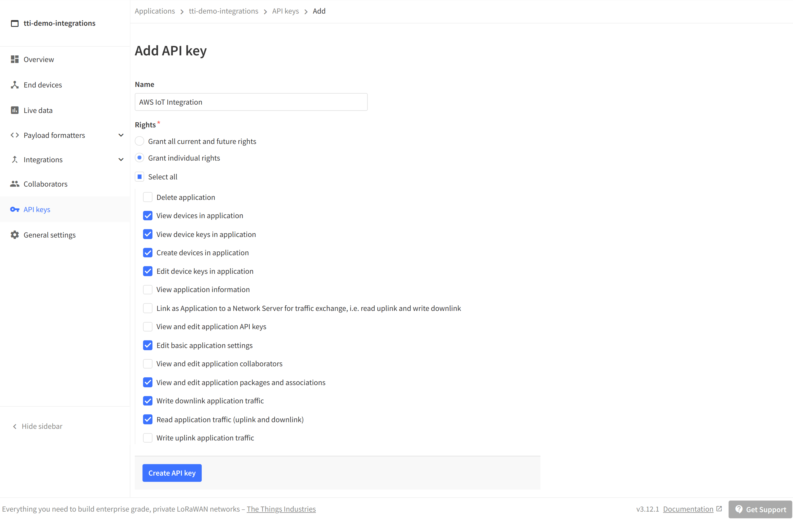
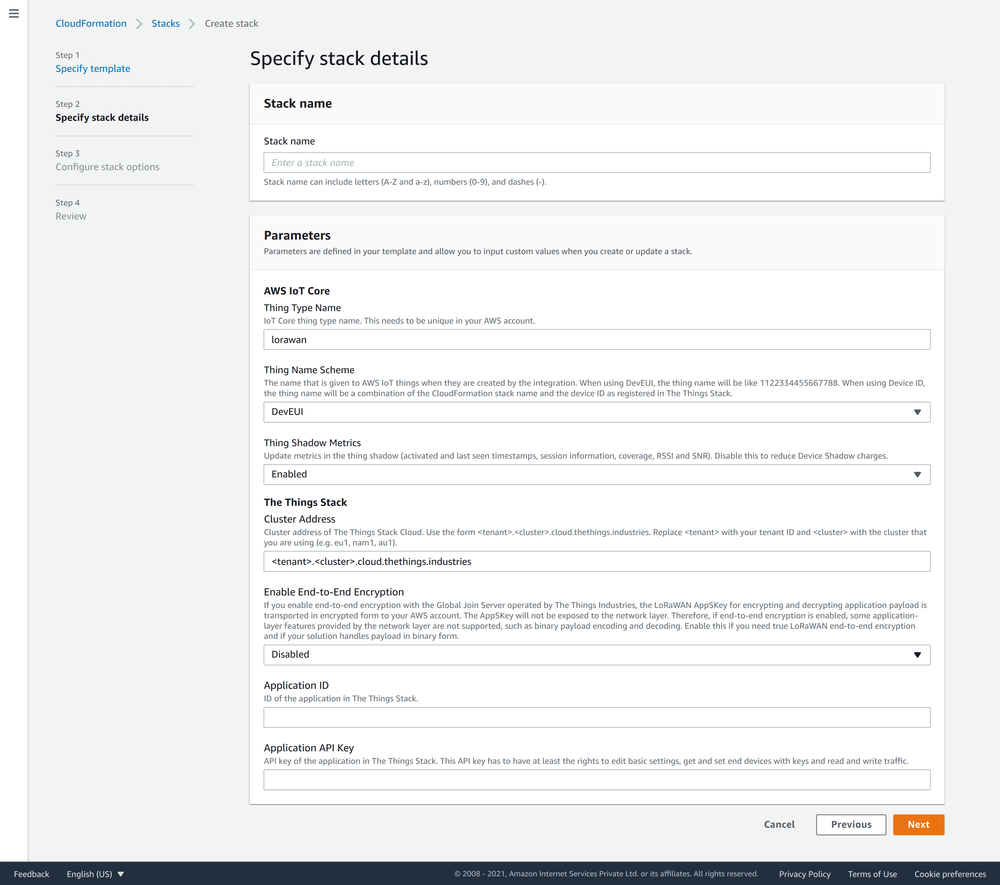

# Deployment Guide

> Learn how to deploy the AWS IoT integration for The Things Stack.

Source: https://www.thethingsindustries.com/docs/integrations/cloud-integrations/aws-iot/deployment-guide/

Learn how to deploy the AWS IoT integration for The Things Stack.

## Prerequisites

1. Access to an AWS account. [Create a new account](https://aws.amazon.com/resources/create-account/)
2. An application in The Things Stack. [See instructions](https://www.thethingsindustries.com/docs/integrations/adding-applications/)

## Create API Key

Go to your application in The Things Stack Console, go to **API keys** and click **+ Add API key**.

Enter a name, like **AWS IoT integration**, and grant at least the following individual rights:

- View devices in application
- View device keys in application
- Create devices in application
- Edit device keys in application
- Edit basic application settings
- View and edit application packages and associations
- Write downlink application traffic
- Read application traffic (uplink and downlink)

Click **Create API key**, copy the key and store it in a safe place. You need the API key in the next section.

## Deploy AWS CloudFormation Template

  <label class="label" for="aws-region-selector-5-aws-region">Select your AWS region</label>
  

    

      <select id="aws-region-selector-5-aws-region" data-content="aws-region">
        <option value="af-south-1" >Africa, Cape Town (af-south-1)</option>
        <option value="ap-east-1" >Asia Pacific, Hong Kong (ap-east-1)</option>
        <option value="ap-south-1" >Asia Pacific, Mumbai (ap-south-1)</option>
        <option value="ap-northeast-2" >Asia Pacific, Seoul (ap-northeast-2)</option>
        <option value="ap-southeast-1" >Asia Pacific, Singapore (ap-southeast-1)</option>
        <option value="ap-southeast-2" >Asia Pacific, Sydney (ap-southeast-2)</option>
        <option value="ap-northeast-1" >Asia Pacific, Tokyo (ap-northeast-1)</option>
        <option value="ca-central-1" >Canada, Central (ca-central-1)</option>
        <option value="eu-central-1" >Europe, Frankfurt (eu-central-1)</option>
        <option value="eu-west-1" >Europe, Ireland (eu-west-1)</option>
        <option value="eu-west-2" >Europe, London (eu-west-2)</option>
        <option value="eu-south-1" >Europe, Milan (eu-south-1)</option>
        <option value="eu-west-3" >Europe, Paris (eu-west-3)</option>
        <option value="eu-north-1" >Europe, Stockholm (eu-north-1)</option>
        <option value="me-south-1" >Middle East, Bahrein (me-south-1)</option>
        <option value="sa-east-1" >South America, São Paulo (sa-east-1)</option>
        <option value="us-west-1" >United States, North California (us-west-1)</option>
        <option value="us-east-1" selected>United States, North Virginia (us-east-1)</option>
        <option value="us-east-2" >United States, Ohio (us-east-2)</option>
        <option value="us-west-2" >United States, Oregon (us-west-2)</option>
      </select>
    

  

**Cloud:**

[View template](https://s3.amazonaws.com/thethingsindustries/integration-aws/latest/cloudhosted.template.json)

**Enterprise:**

[View template](https://s3.amazonaws.com/thethingsindustries/integration-aws/latest/selfhosted.template.json)

**Sandbox:**

[View template](https://s3.amazonaws.com/thethingsindustries/integration-aws/latest/community.template.json)

> **Warning:** Make sure to select the template related to your deployment only.

### Settings

The **Stack name** is the unique name identifying the integration in your AWS account.

The parameters configure the integration:

- **Principal Account ID** 

  
    
  

  

: AWS Account ID that The Things Stack authenticates with.
- **Thing Type Name**: The unique AWS IoT Core thing type name for this integration.
- **Thing Name Scheme**: The name that is given to AWS IoT things when they are created by the integration.
  - When using `DevEUI`, the name will appear as the numeric DevEUI, i.e 1122334455667788.
  - When using `DeviceID`, the thing name will be a combination of the CloudFormation stack name and the device ID as registered in The Things Stack, i.e. `<stackName>_<DeviceID>`.
- **Thing Shadow Metrics**: Enable or disable updating the thing shadow with metrics.
- **Cluster Address**: The cluster address of your The Things Stack deployment.
  - When using **The Things Stack Cloud**, go to [The Things Stack Cloud Addresses](https://www.thethingsindustries.com/docs/cloud/addresses/) to find your cluster address
  - When using **The Things Stack Enterprise**, enter your cluster address
  - When using **The Things Network**, select the community cluster from the dropdown
- **Application ID**: The application ID for which you configure the integration.
- **Application API Key**: The application API key that you generated before.

> **Note:** If you use The Things Network Stack V2 integration for AWS IoT, you must change the **Thing Type Name** to something other than `lorawan` to avoid conflicts.

Check **I acknowledge that AWS CloudFormation might create IAM resources**.

Click **Create stack**.

> **Note:** Creating all resources can take up to five minutes. ☕

When the deployment is done, you'll see the status `CREATE_COMPLETE`.

> Congratulations! 🎉 You have now set up the AWS IoT integration for The Things Stack!

