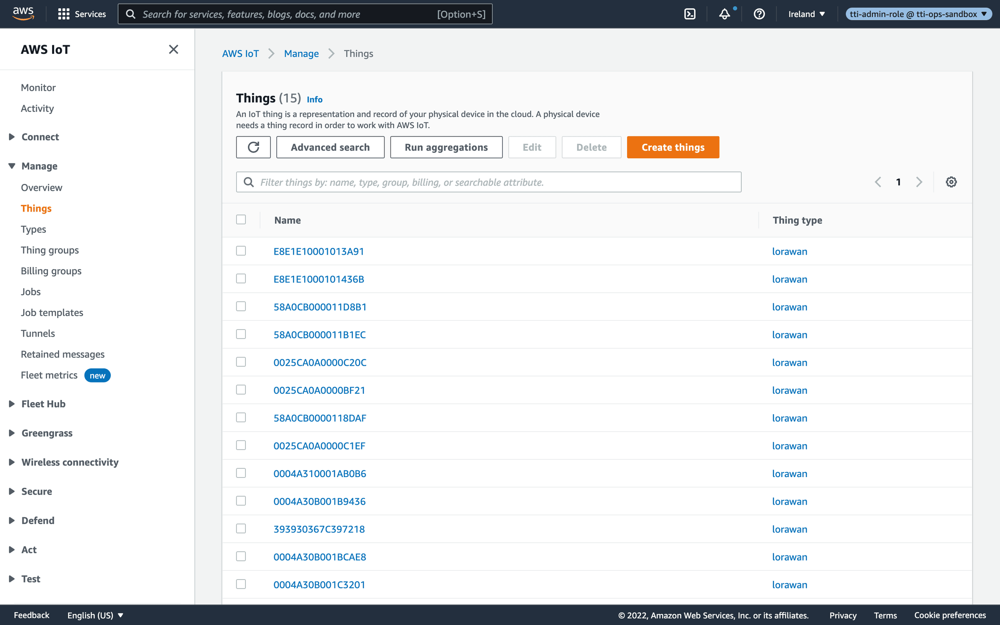
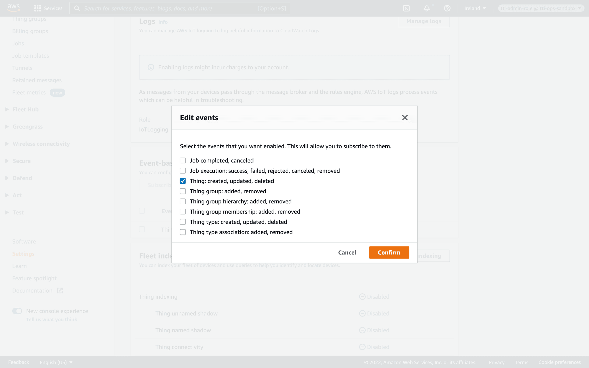
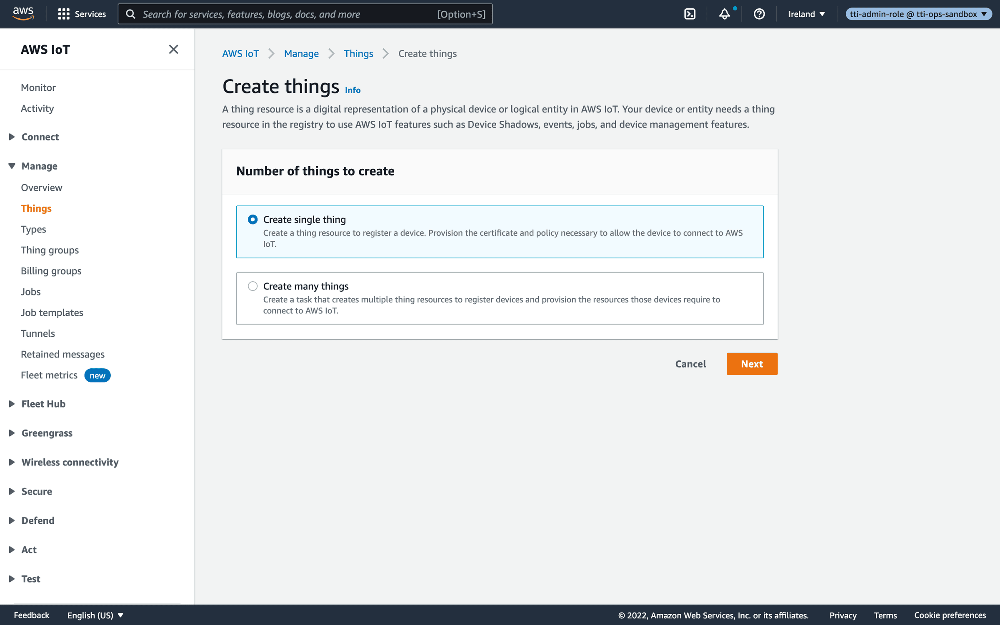
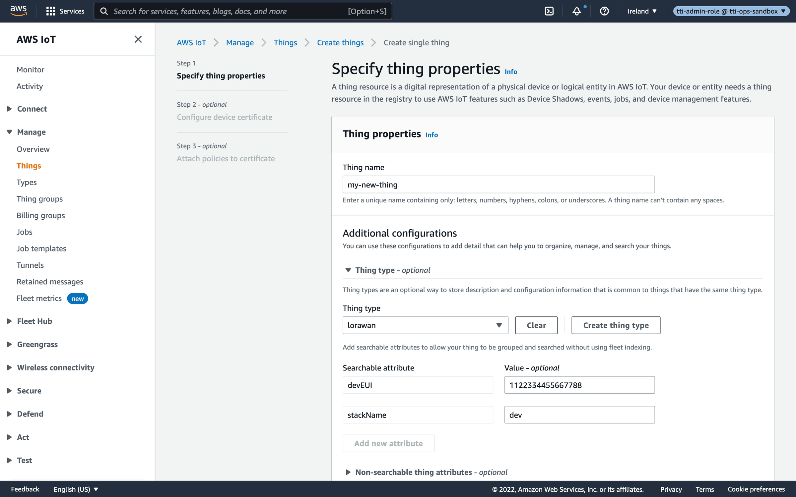
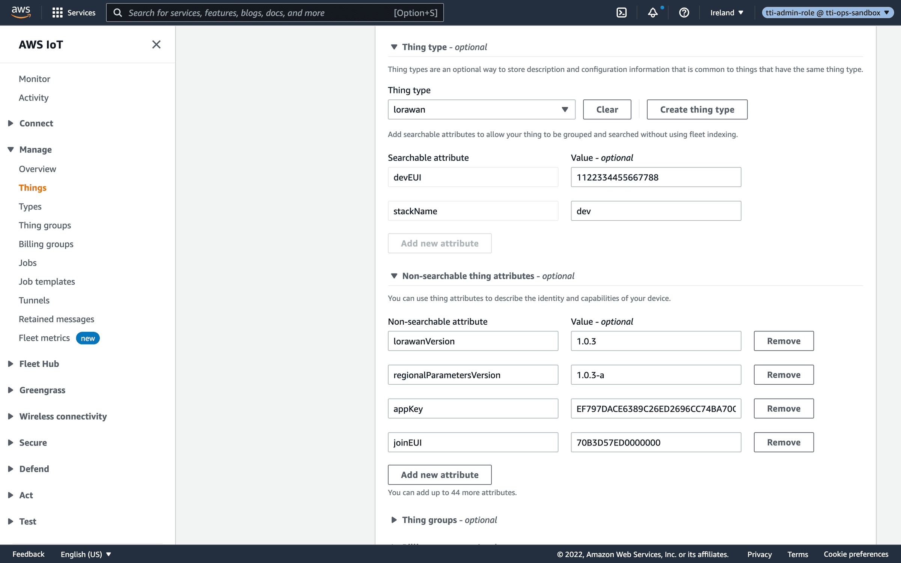

# Managing Things

> The AWS IoT Integration for The Things Stack synchronizes the device registry: you can create and claim things in AWS IoT Core which trigger a Lambda function …

Source: https://www.thethingsindustries.com/docs/integrations/cloud-integrations/aws-iot/things/

The AWS IoT Integration for The Things Stack synchronizes the device registry: you can create and claim things in AWS IoT Core which trigger a Lambda function that creates or claims the device in The Things Stack.

> **Note:** Devices that you create in The Things Stack are automatically created as AWS IoT Core things as soon as they activate or send their first uplink message.
> 
> Create and claim things only for devices that are not yet in your The Things Stack application.

## Thing Type and Names

The AWS IoT Integration for The Things Stack uses the thing that you specified when deploying the integration. By default, the thing type is `lorawan`.

Things are created automatically as they join the network or send an uplink message. For the name of new things, you can use their `<DevEUI>` or `<stackName>_<DeviceID>`.

> **Note:** - `stackName`: the AWS CloudFormation stack name of your deployment
> - `DeviceID`: the device-id of your device

Your AWS IoT things overview may look like this:

## Preparation

In order to create and claim things in AWS IoT, you need to enable event-based messages. This enables the AWS IoT Integration to act on thing create, update and delete events.

In the AWS Console, open **Services** and go to **IoT Core**.

In the menu on the left, in the bottom, click **Settings**.

In the **Event-based messages** pane, click **Manage events**.

Make sure that at least **Thing: created, updated, deleted** is checked.

## Creating Things

You can use AWS IoT to create devices in The Things Stack. This is useful to manage all your things in one place, without having to use The Things Stack Console, CLI or API.

Creating a Thing allows you to add any LoRaWAN® device by manually entering its information and security keys.

In the AWS Console, open **Services** and go to **IoT Core**.

In the menu on the left, click **Manage**, go to **Things** and click **Create things** in the top-right.

Select **Create a single thing** and click **Next**.

As **Name**, enter any thing name you like.

Make sure that **Thing type** is set to the correct thing type, by default `lorawan`.

There are two **Searchable attributes** that come with the thing type: `devEUI` and `stackName`:

- `devEUI`: the hexadecimal LoRaWAN DevEUI.
- `stackName`: the AWS CloudFormation stack name of your deployment. This makes sure that the things are unique and kept apart if you use multiple AWS IoT Integrations side-by-side in your AWS account.

Next, you can create a new device by specifying all required attributes under **Non-searchable thing attributes**:

- `joinEUI`: the hexadecimal LoRaWAN JoinEUI (or AppEUI). You may also specify `appEUI` instead.
- `lorawanVersion`: either `1.0`, `1.0.1`, `1.0.2`, `1.0.3` or `1.1`
- `regionalParametersVersion`: either `1.0`, `1.0.1`, `1.0.2` (or `1.0.2-a`), `1.0.2-b`, `1.0.3-a`, `1.1-a` or `1.1-b`
- `appKey`: hexadecimal LoRaWAN AppKey
- `nwkKey`: hexadecimal LoRaWAN NwkKey (only when using LoRaWAN 1.1 or higher)
- Optional `deviceID`: the device ID that will be used to create the device in your The Things Stack application. When omitted, the integration uses `eui-<dev-eui>` as device ID. See [ID and EUI constraints](https://www.thethingsindustries.com/docs/concepts/architecture/id-eui-constraints/) for accepted ID formats.
- Optional `frequencyPlanID`: the frequency plan ID. See [Frequency Plans](https://www.thethingsindustries.com/docs/concepts/features/lorawan/frequency-plans/) for the supported values. When omitted, the default frequency plan of your AWS region is used. See the **Outputs** section of your AWS CloudFormation stack to see which one that is.

> **Note:** Any errors during Creating Things will be propagated to CloudWatch. See [Troubleshooting](https://www.thethingsindustries.com/docs/concepts/features/lorawan/frequency-plans/) for more information about retrieving logs.

Click **Next**.

Click **Skip certificate and create thing**.

> **Note:** Certificates are used when your AWS IoT thing is capable of TLS client authentication. This is not applicable to LoRaWAN end devices. Therefore, you don't need to manage certificates for LoRaWAN devices in AWS IoT.

Your thing is now created. Please see [Troubleshooting](https://www.thethingsindustries.com/docs/integrations/cloud-integrations/aws-iot/troubleshooting/) if your device is not showing up in your The Things Stack application.

