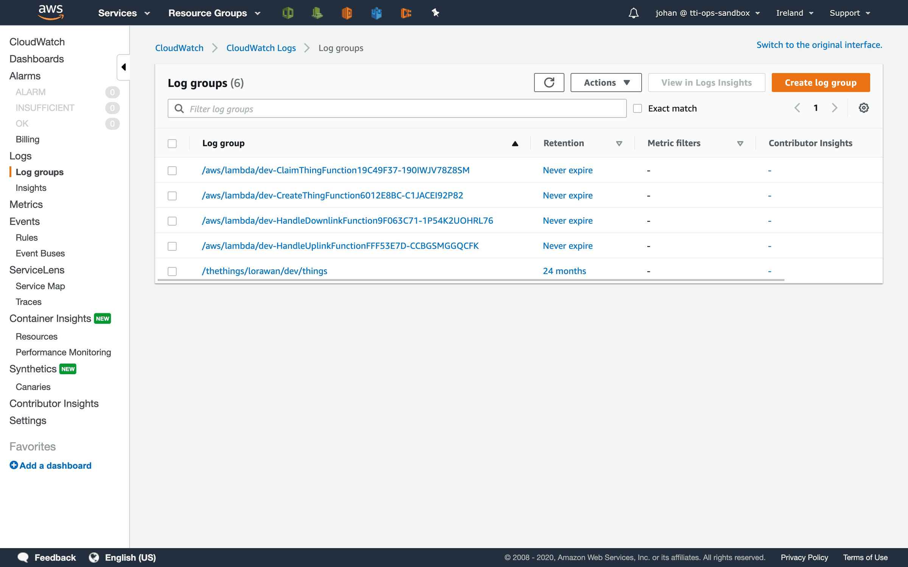

# Troubleshooting AWS IoT Integration

> The AWS IoT Integration for The Things Stack puts logs to AWS CloudWatch where you can find detailed traces and errors.

Source: https://www.thethingsindustries.com/docs/integrations/cloud-integrations/aws-iot/troubleshooting/

The AWS IoT Integration for The Things Stack puts logs to AWS CloudWatch where you can find detailed traces and errors.

## CloudWatch logs

In the AWS Console, open **Services** and go to **CloudWatch**.

In the menu on the left, under **Logs**, go to **Log Groups**.

> **Note:** **Not seeing all log groups?** The log groups are created automatically when a Lambda function runs. If the function did not run yet, the log group is not there.

First place to look for issues with thing creation or claiming is the `/thethings/lorawan/<stack-name>/things` log group. Each thing has its own log stream in this log group. For example, if you [created or claimed a thing](https://www.thethingsindustries.com/docs/integrations/cloud-integrations/aws-iot/things/) but it doesn't show up in The Things Stack, you can find the cause in the thing's log stream.

For further details, you can look at the log entries of the Lambda functions:

- `/aws/lambda/<stack-name>-ConfigureFunction...`: configuration
- `/aws/lambda/<stack-name>-CreateThingTypeFunction...`: create the thing type
- `/aws/lambda/<stack-name>-CreateThingFunction...`: thing creation
- `/aws/lambda/<stack-name>-HandleDownlinkFunction...`: downlink handling
- `/aws/lambda/<stack-name>-HandleUplinkFunction...`: uplink handling

## Resolving issues

### "DevEUI is registered for mismatching stack" error

This error occurs when the AWS IoT Integration wants to process an event for an IoT Core thing, but that thing is not managed by the AWS IoT Integration.

AWS IoT Core things used by the AWS IoT Integration are unique in the AWS account. They must have an attribute `stackName` that equals the **Stack name** of the integration.

There are three possible causes, with a each a solution:

1. There was a previous AWS IoT Integration in the same AWS account that created the things in IoT Core, and that integration used a different **Stack name**
   - **Solution 1:** Delete the IoT Core things. They will be recreated automatically
   - **Solution 2:** Update the `stackName` attribute of the concerning IoT Core things to match the **Stack name** of the new integration. See [Deployment guide](./deploy-ment-guide)
2. There is another AWS IoT Integration deployed in the same AWS account, possibly connected to the same The Things Stack application
   - **Solution:** No two AWS IoT Integrations can manage the same IoT Core things. The IoT Core thing name is the DevEUI, and that must be globally unique. If you must, deploy the second AWS IoT Integration in different AWS account
3. The IoT core thing has been created via another way, e.g. manual create or another application
   - **Solution 1:** Update the `stackName` attribute of the concerning IoT Core things to match the **Stack name** of the new integration. See [Deployment guide](./deploy-ment-guide)
   - **Solution 2:** Use a different AWS account
   - **Solution 3:** If you do not longer need the (manually) created IoT Core thing, delete it

### "Invalid token" error

If the API key used during deployment of the AWS IoT integration is incorrect, deployment will fail with the `error:pkg/auth:token(invalid token)` error. Check out [AWS IoT Deployment guide](https://www.thethingsindustries.com/docs/integrations/cloud-integrations/aws-iot/deployment-guide/#create-api-key) and make sure you're using an API key with required rights for this integration. You can also create a new API key and re-deploy the integration. 
