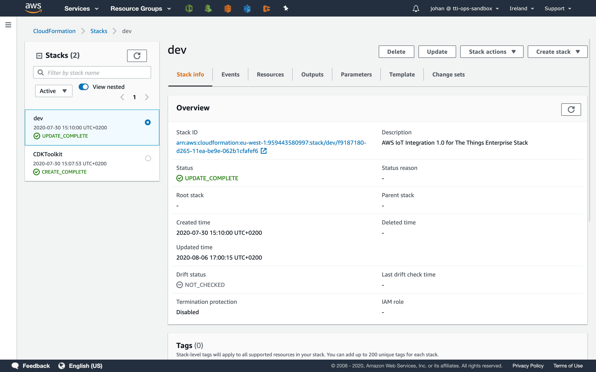

# Uninstall

> You can uninstall the AWS IoT integration for The Things Stack using AWS CloudFormation.

Source: https://www.thethingsindustries.com/docs/integrations/cloud-integrations/aws-iot/uninstall/

You can uninstall the AWS IoT integration for The Things Stack using AWS CloudFormation.

> **Note:** Disabling the AWS IoT integration in The Things Stack only stops traffic from being published to AWS IoT Core. On the other hand, deleting devices on AWS IoT side will also delete them from The Things Stack, even if the AWS IoT integration is disabled on The Things Stack side.
> 
> If you want to delete devices from AWS IoT Core without deleting them from The Things Stack, follow the section below.

## Delete AWS CloudFormation Stack

In the AWS Console, open **Services** and go to **CloudFormation**.

In the list of stacks, go to the stack that you created when deploying the integration. See [Deployment Guide](https://www.thethingsindustries.com/docs/integrations/cloud-integrations/aws-iot/deployment-guide/).

In the top-right, click **Delete**.

Double check that you are deleting the right AWS CloudFormation stack. Proceed with **Delete stack**.

> **Note:** Deleting all resources may take a few minutes.

When the stack is deleted, the AWS CloudFormation stack disappears from the list.

