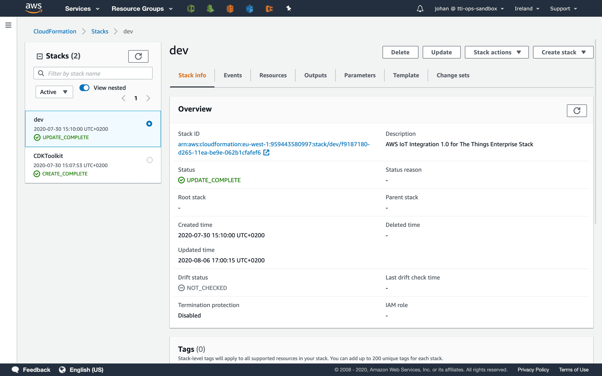
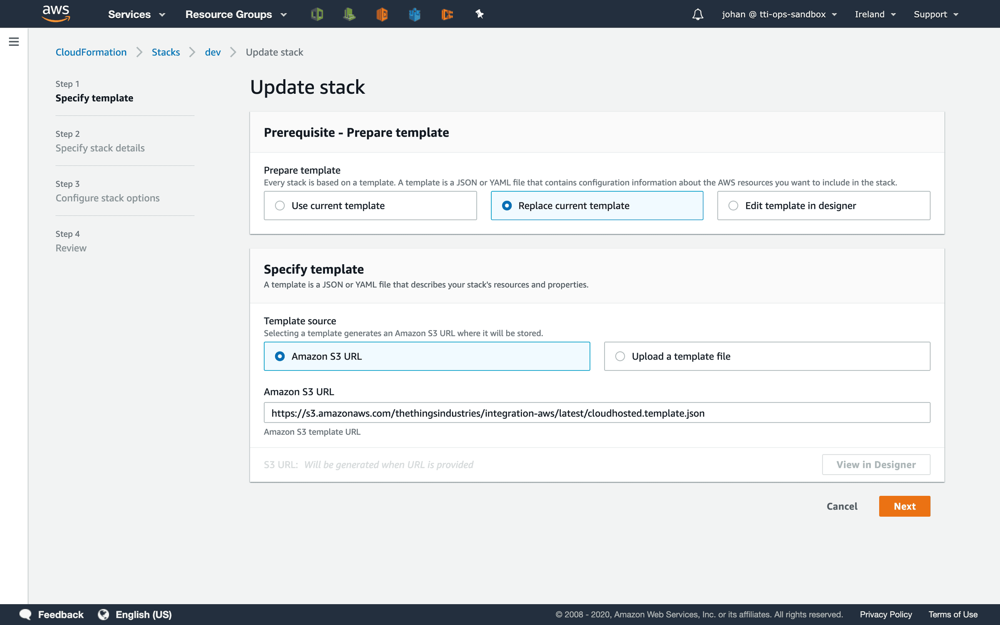
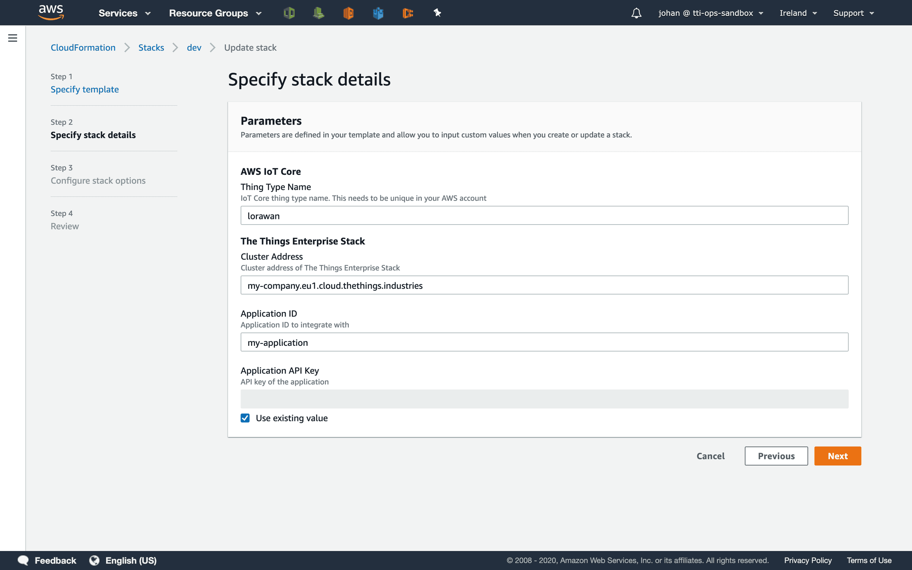
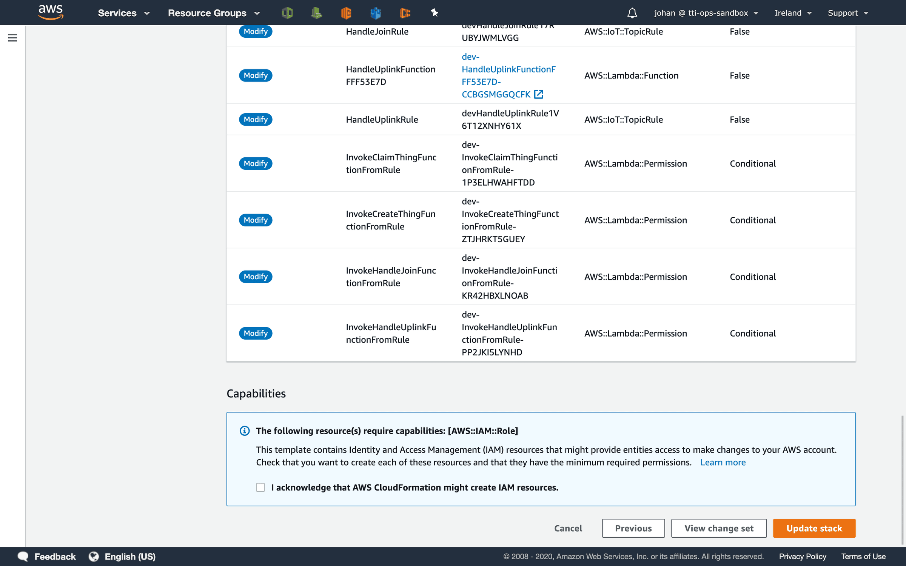

# Update

> You can update the AWS IoT integration for The Things Stack using AWS CloudFormation easily. In most cases, this is without service interruptions.

Source: https://www.thethingsindustries.com/docs/integrations/cloud-integrations/aws-iot/update/

You can update the AWS IoT integration for The Things Stack using AWS CloudFormation easily. In most cases, this is without service interruptions.

In the AWS Console, open **Services** and go to **CloudFormation**.

In the list of stacks, go to the stack that you created when deploying the integration. See [Deployment Guide](https://www.thethingsindustries.com/docs/integrations/cloud-integrations/aws-iot/deployment-guide/).

In the top-right, click **Update**.

Select **Replace current template**.

In the **Amazon S3 URL** enter the following URL depending on your deployment:

**Cloud:**

`https://s3.amazonaws.com/thethingsindustries/integration-aws/latest/cloudhosted.template.json`

**Enterprise:**

`https://s3.amazonaws.com/thethingsindustries/integration-aws/latest/selfhosted.template.json`

**Sandbox:**

`https://s3.amazonaws.com/thethingsindustries/integration-aws/latest/community.template.json`

This URL always contain the latest version.

Click **Next**.

Review the parameters. Unless new functionality adds new parameters, you can leave the current values unchanged.

Click **Next** and click **Next** again.

Review the update and changes. Scroll down.

Check **I acknowledge that AWS CloudFormation might create IAM resources.**.

Click **Update stack**.

> **Note:** Updating all resources can take up to 5 minutes.

When the deployment is updated, you'll see the status `UPDATE_COMPLETE`.

