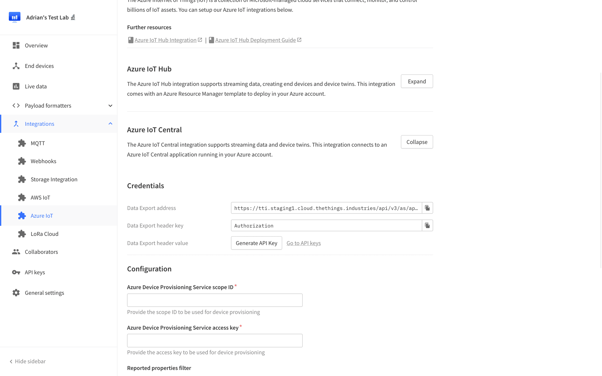
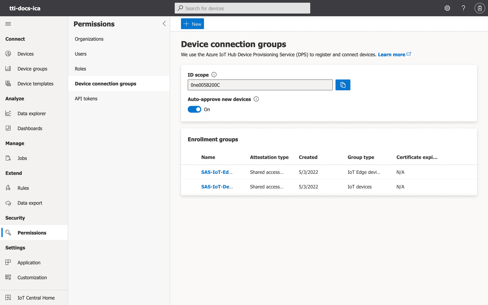
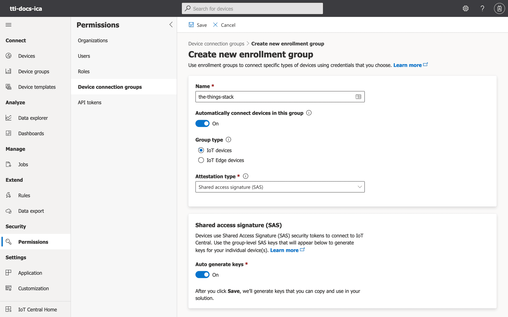
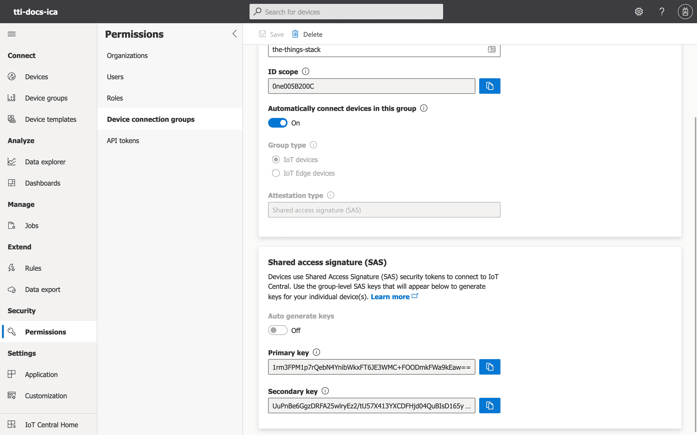
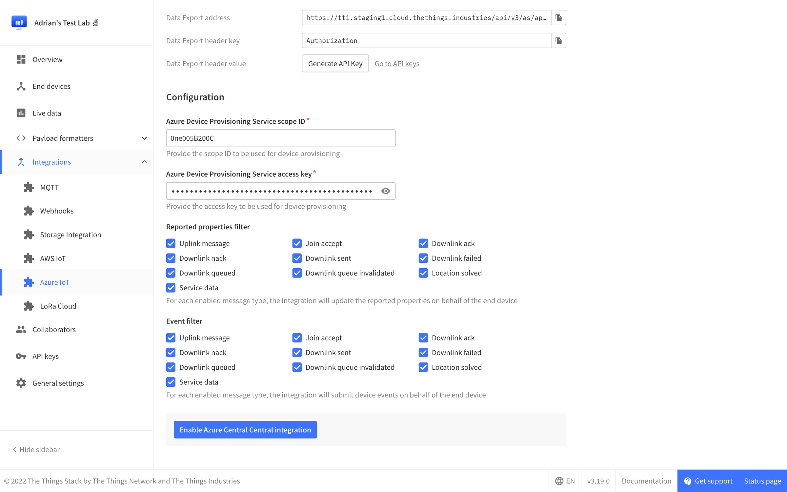
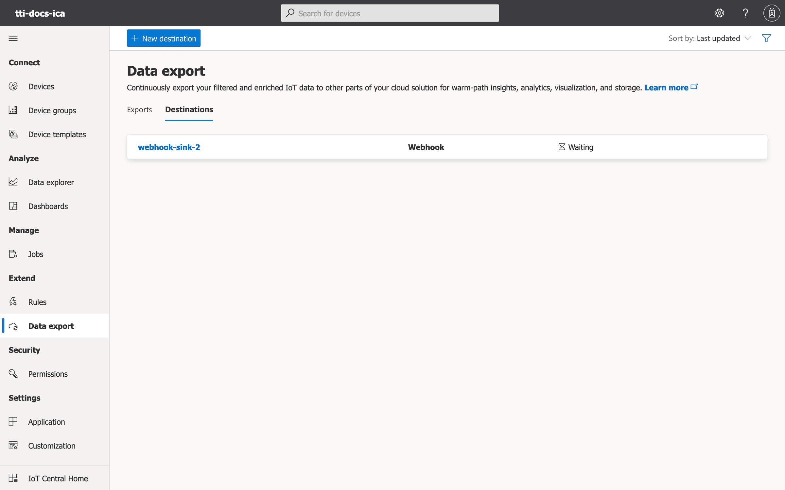
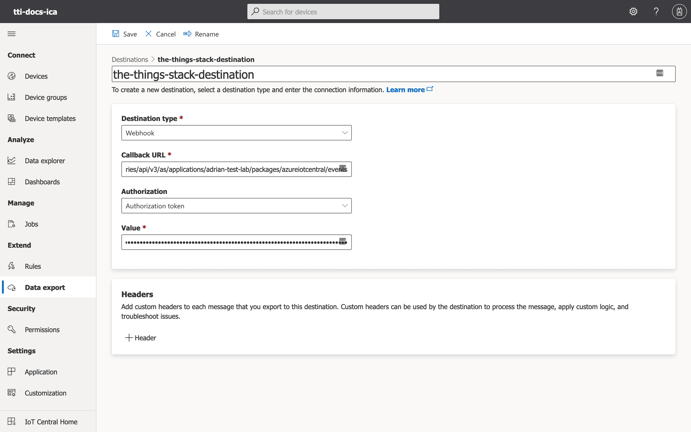
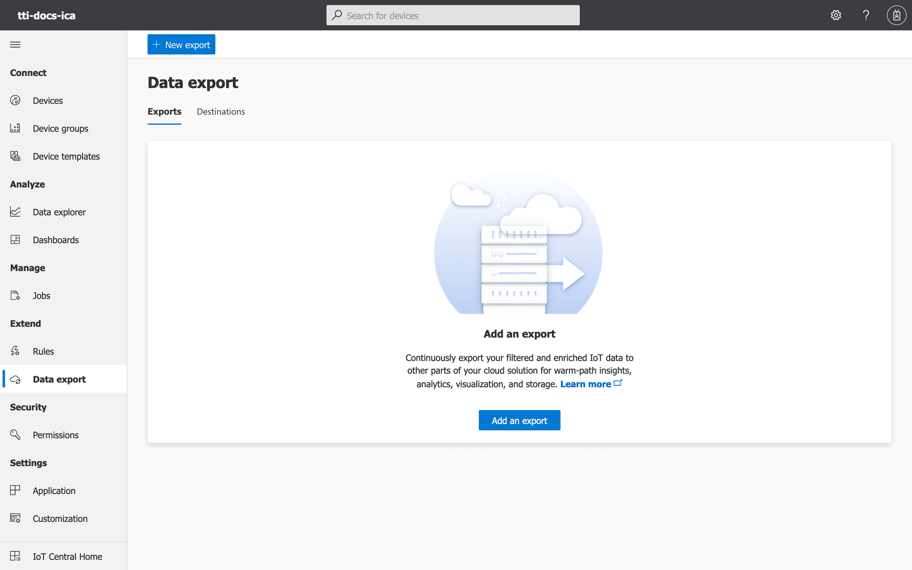
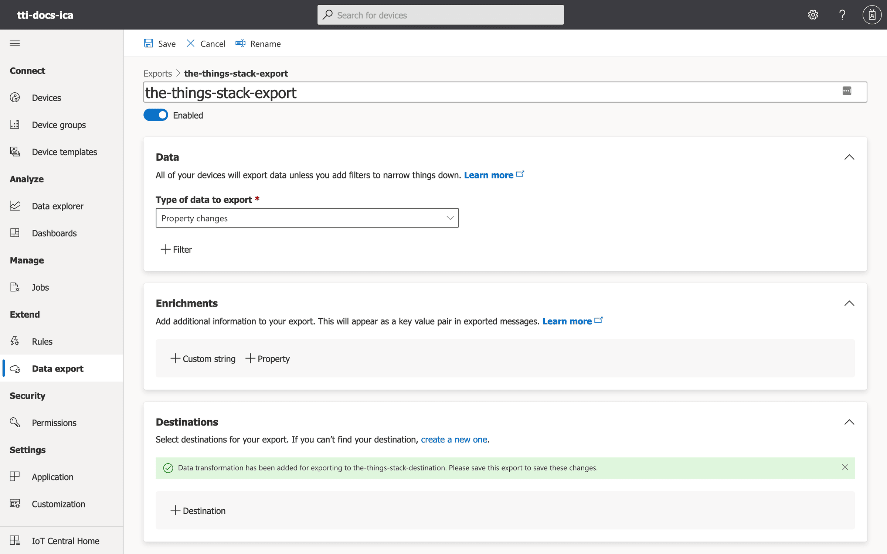
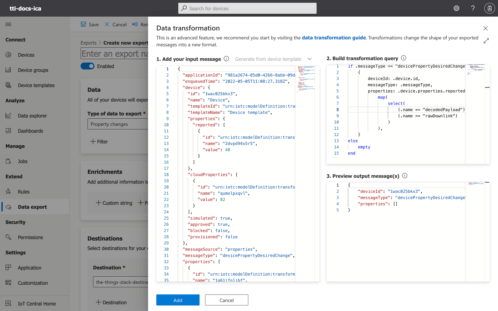

# Deployment Guide

> Learn how to deploy the Azure IoT Central integration for The Things Stack.

Source: https://www.thethingsindustries.com/docs/integrations/cloud-integrations/azure-iot-central/deployment/


Learn how to deploy the Azure IoT Central integration for The Things Stack.

## Prerequisites

1. Access to an Azure account. [Create a new account](https://signup.azure.com/)
2. An application in The Things Stack. [See instructions](https://www.thethingsindustries.com/docs/integrations/adding-applications/)

## Create API Key

Go to your application in The Things Stack Console, navigate to **Integrations &#8594; Azure IoT** on the left hand menu and click on **Expand** next to **Azure IoT Central**. Now click on **Generate API Key**.




Copy the generated API key and store it in a safe place, because you will need it in the next section.

Leave the integration page open, as you will need to copy in your **Azure Device Provisioning Service scope ID** and **Azure Device Provisioning Service access key** before saving the integration.

## Create Device Connection Group

Go to your Azure IoT Central Application, navigate to **Permissions &#8594; Device connection groups** on the left hand menu and click on **+ New**.




Enter a **Name** for your Device Connection group, such as `the-things-stack`, then select the **Attestation type** **_Shared access signature (SAS)_**, then click on **Save**




You will now be presented with the Device Connection Group overview.




The **ID scope** can now be copied into your integration settings as **Azure Device Provisioning Service scope ID**, and the **Primary key** can be copied as the **Azure Device Provisioning Service access key**. Click on **Enable/Update Azure IoT Central integration**.




## Data Export

Go back to your Azure IoT Central Application, navigate to **Data export** on the left hand menu.

Activate the **Destinations** tab and click on **+ New destination**.




Enter a **Destination name**, such as `the-things-stack-destination`.

Select the **Destination type** **_Webhook_**, then enter the **Callback URL** mentioned in the The Things Stack Azure IoT Central integration page under **Data Export address**.

Select the **Authorization** **_Authorization token_** and input the API key generated in the previous step. Click on **Save**.




Navigate to **Data export &#8594; Exports** on the left hand menu and click on **+ New export**.




Enter a **Export name**, such `the-things-stack-export`.

Select the **Type of data to export** **_Property changes_**.

Click on **+Destinations**.




Under **Select your destination** chose the export destination you have create previously.

Click on **+Transform** and input the following query under **2. Build transformation Query**.

```
if .messageType == "devicePropertyDesiredChange" then
    {
        deviceId: .device.id,
        messageType: .messageType,
        properties: .device.properties.reported |
            map(
                select(
                    (.name == "decodedPayload") or
                    (.name == "rawDownlink")
                )
            ),
    }
else
    empty
end
```

Click on **Add**.




Click on **Save** in order to save the Data Export.

> Congratulations! 🎉 You have now set up the Azure IoT Central integration for The Things Stack!

