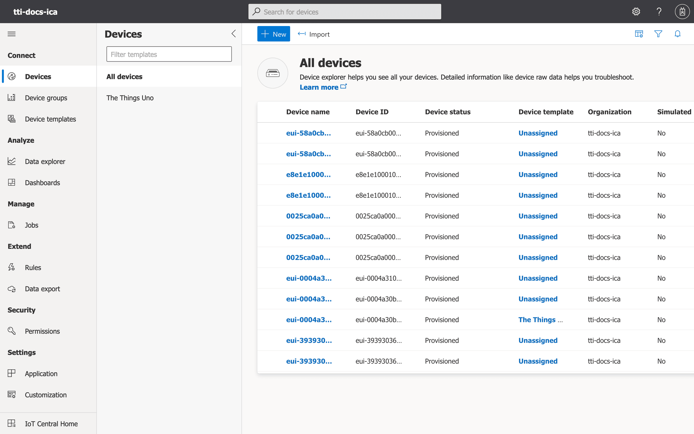
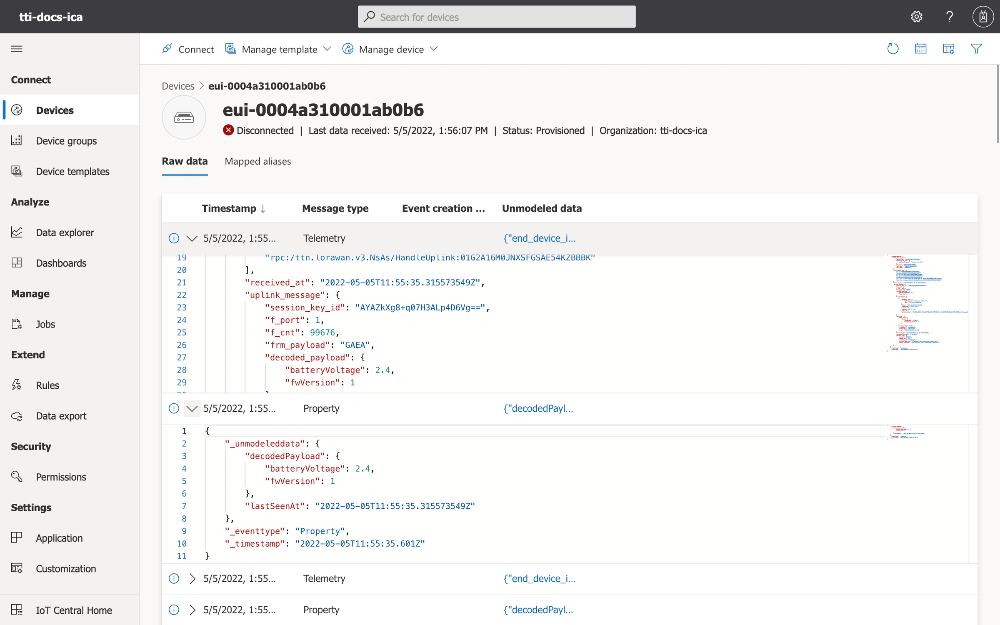

# Telemetry and Device Twin

> The Things Stack publishes uplink messages to Azure IoT Central as device telemetry. The Things Stack updates the Device Twin reported properties of the device, …

Source: https://www.thethingsindustries.com/docs/integrations/cloud-integrations/azure-iot-central/device-twin/


The Things Stack publishes uplink messages to Azure IoT Central as device telemetry. The Things Stack updates the [Device Twin](https://docs.microsoft.com/en-us/azure/iot-hub/iot-hub-devguide-device-twins) reported properties of the device, and schedules downlinks when the [Device Twin](https://docs.microsoft.com/en-us/azure/iot-hub/iot-hub-devguide-device-twins) desired properties are changed.

> The Things Stack automatically creates the end device in Azure IoT Central in case it is not yet created.

> See [Architecture](https://www.thethingsindustries.com/docs/integrations/cloud-integrations/azure-iot-central/architecture/) for the flow.

> **Note:** The [Device Twin](https://docs.microsoft.com/en-us/azure/iot-hub/iot-hub-devguide-device-twins) properties functionality depends on the presence of [Payload Formatters](https://www.thethingsindustries.com/docs/integrations/payload-formatters/). Devices which are configured using [LoRaWAN Device Repository](https://www.thethingsindustries.com/docs/integrations/payload-formatters/device-repo/) will automatically have payload formatters.


## Telemetry

The Azure IoT Central integration will automatically publish telemetry messages when an uplink message arrives, using [Payload Formatters](https://www.thethingsindustries.com/docs/integrations/payload-formatters/). You can see the raw, unmodeled data in the Azure IoT Central device view.

Go to your Azure IoT Central Application, navigate to **Devices &#8594; All devices** on the left hand menu and click on the name of one of your devices.




Clicking on a row will automatically open the payload for review.




Telemetry messages will always contain to the The Things Stack application uplink format, serialized as a JSON. You can find the formal message definition [here](https://www.thethingsindustries.com/docs/api/reference/grpc/storage_integration/#message:ApplicationUp).

## Properties

The reported properties which the integration will generate are as follows:

- `joinedAt` - Timestamp (in [RFC3339 format](https://datatracker.ietf.org/doc/html/rfc3339)) at which the end device has joined the network. It is generated when a join accept message is processed by the integration. A consequence is that devices which have joined before the integration was enabled will lack the timestamp until they join again.

An example of this property as unmodeled data would look as follows:

```json
{
  "joinedAt": {
    "reported": {
      "value": "2022-05-05T12:59:42.386820749Z"
    }
  },
  "_eventtype": "Property",
  "_timestamp": "2022-05-05T12:59:42.619Z"
}
```

- `lastSeenAt` - Timestamp (in [RFC3339 format](https://datatracker.ietf.org/doc/html/rfc3339)) of the last uplink message from the end device. This property exists as The Things Stack may generate telemetry messages for downlink queue operations, which will pollute the native Azure IoT Central last seen timestamp (since queueing a downlink message does not imply that the end device has been active).

An example of this property as unmodeled data would look as follows:

```json
{
  "lastSeenAt": {
    "reported": {
      "value": "2022-05-05T12:59:42.386820749Z"
    }
  },
  "_eventtype": "Property",
  "_timestamp": "2022-05-05T12:59:42.619Z"
}
```

- `location` - Object mapping between the service (name) which has located the end device and the location of the end device. You can find the formal definition of a singular location [here](https://www.thethingsindustries.com/docs/api/reference/grpc/storage_integration/#message:Location).

An example of this property as unmodeled data would look as follows:

```json
{
  "_unmodeleddata": {
    "location": {
      "frm-payload": {
        "latitude": 52.457278,
        "longitude": 6.44181,
        "accuracy": 64,
        "source": "SOURCE_GPS"
      }
    }
  },
  "_eventtype": "Property",
  "_timestamp": "2022-05-05T12:46:31.988Z"
}
```

> `frm-payload` is the service name for the service which derives the end device location from the decoded payload.

- `serviceData` - Object mapping between the service (name) and the service data reported by that service. Used by third-party integrations.
- `decodedPayload` - Decoded payload of the uplink messages, which is generated using the [Payload Formatters](https://www.thethingsindustries.com/docs/integrations/payload-formatters/).

An example of this property as unmodeled data would look as follows:

```json
{
  "decodedPayload": {
    "reported": {
      "value": {
        "ledState": "off"
      }
    }
  },
  "_eventtype": "Property",
  "_timestamp": "2022-05-05T12:59:42.619Z"
}
```

The desired properties which the integration will process are as follows:

- `decodedPayload` - Decoded payload of a downlink message, which is encoded using the [Payload Formatters](https://www.thethingsindustries.com/docs/integrations/payload-formatters/).
- `rawDownlink` - An object describing the raw downlink settings for the downlink communication. You can find the semantics of the field as part of the Azure IoT Hub integration documentation for [Messages and Device Twin](https://www.thethingsindustries.com/docs/integrations/cloud-integrations/azure-iot-hub/device-twin/#raw-downlinks-hahahugoshortcode-s17-hbhb).

