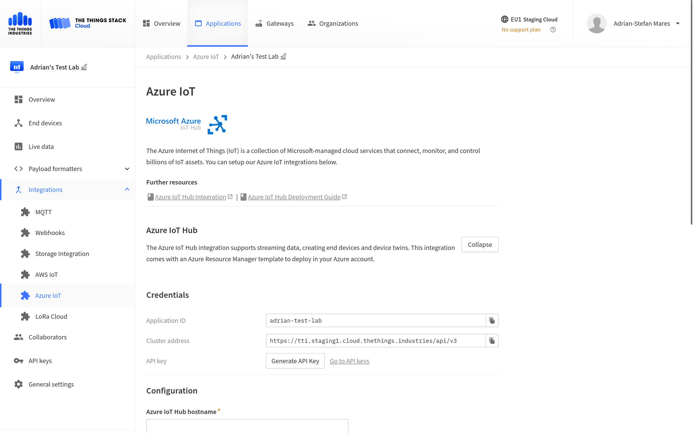
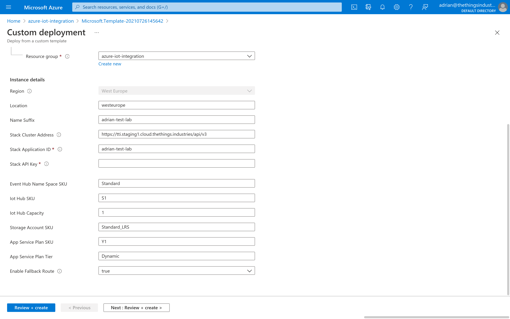
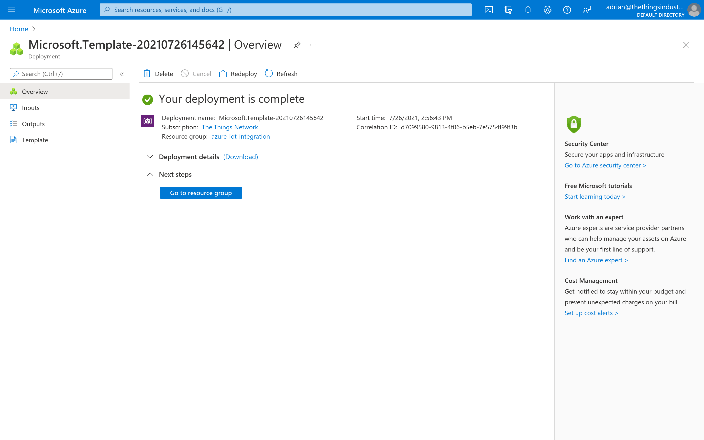
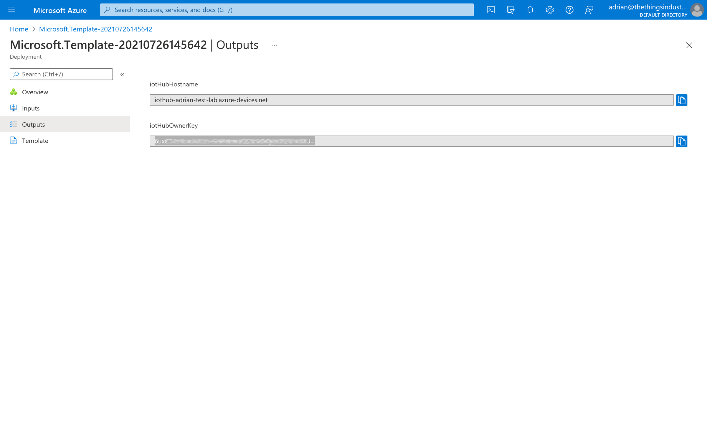
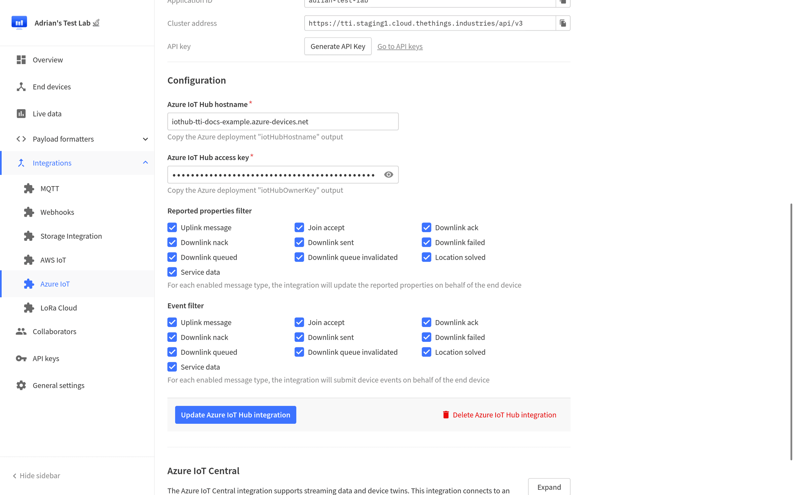

# Deployment Guide

> Learn how to deploy the Azure IoT Hub integration for The Things Stack.

Source: https://www.thethingsindustries.com/docs/integrations/cloud-integrations/azure-iot-hub/deployment/

Learn how to deploy the Azure IoT Hub integration for The Things Stack.

## Prerequisites

1. Access to an Azure account. [Create a new account](https://signup.azure.com/)
2. An application in The Things Stack. [See instructions](https://www.thethingsindustries.com/docs/integrations/adding-applications/)

## Create API Key

Go to your application in The Things Stack Console, navigate to **Integrations &#8594; Azure IoT** on the left hand menu and click on **Expand** next to **Azure IoT Hub**. Now click on **Generate API Key**.

Copy the generated API key and store it in a safe place, because you will need it in the next section.

Leave the integration page open, as you will need to copy in your **Azure IoT Hub hostname** and **Azure IoT Hub access key** before saving the integration.

## Deploy Azure Resource Manager Template

<a href="https://portal.azure.com/#create/Microsoft.Template/uri/https%3A%2F%2Fttsiothubintegration.blob.core.windows.net%2Fintegration-releases%2Flatest%2Fmain.json" target="_blank" class="btn-primary">Deploy template</a>

View template as [JSON](https://ttsiothubintegration.blob.core.windows.net/integration-releases/latest/main.json) or [Bicep](https://ttsiothubintegration.blob.core.windows.net/integration-releases/latest/main.bicep)

### Settings

The following parameters configure the integration:

- **Location**: The region in which the Azure resources will be deployed. Defaults to the region used by the selected Resource Group.
- **Name Suffix**: The suffix added to the Azure Resources. Defaults to a random string.
- **Stack Cluster Address**: The address of your The Things Stack deployment. Can be retrieved from the **Azure IoT** integration page in The Things Stack (see image above).
- **Stack Application ID**: The application ID of your application. Can be retrieved from the **Azure IoT** integration page in The Things Stack (see image above).
- **Stack API Key**: The application API key that you generated in the previous step.
- **Enable fallback route**: Defines if the Azure IoT Hub fallback route should be added. If enabled, uplink messages will be submitted to the default `events` endpoint in your Azure IoT Hub.

Click **Review + Create**, then **Create**.

> **Note:** Creating all resources can take up to five minutes.  ☕

When the deployment is done, you'll see the status `Your deployment is complete`.

After the deployment has finished, click **Outputs**.

The two outputs can now be copied into your integration settings as **Azure IoT Hub hostname** and **Azure IoT Hub access key**. Click on **Enable/Update Azure IoT Hub integration**.

> Congratulations! 🎉 You have now set up the Azure IoT Hub integration for The Things Stack!

