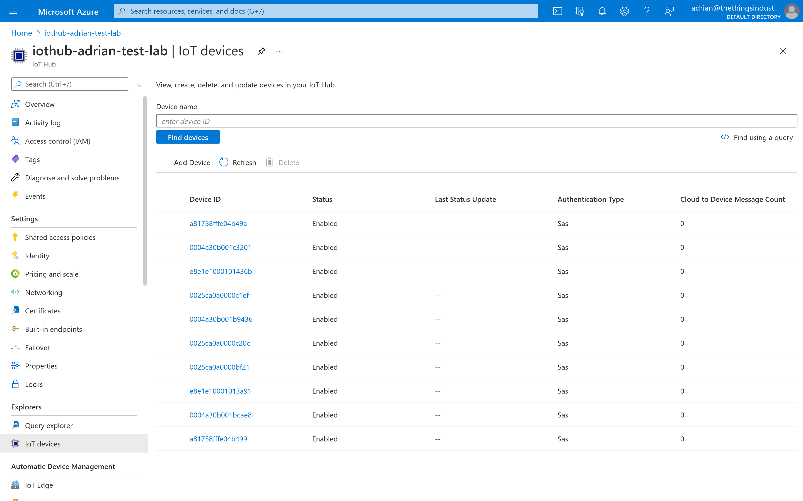
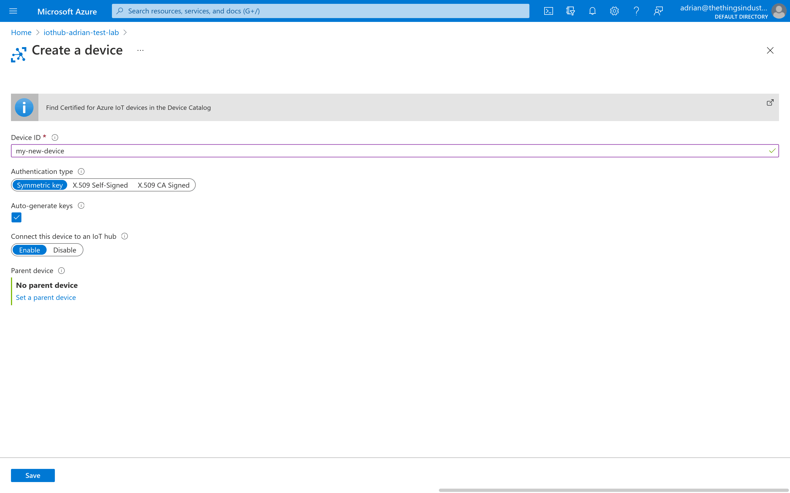
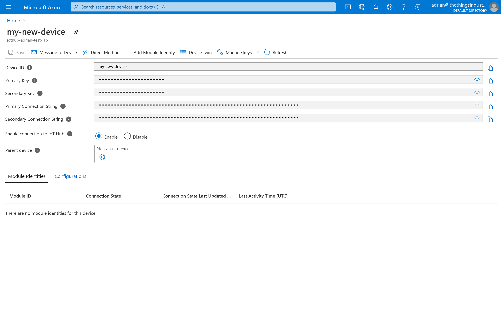
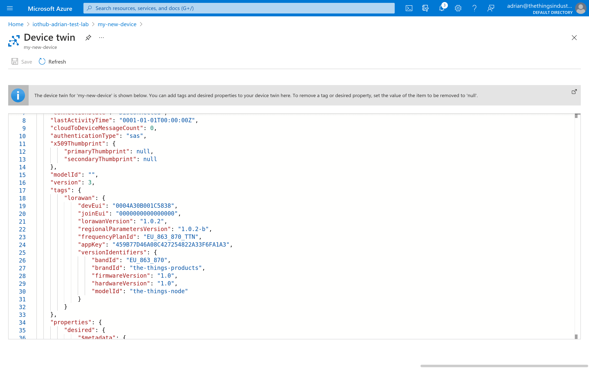
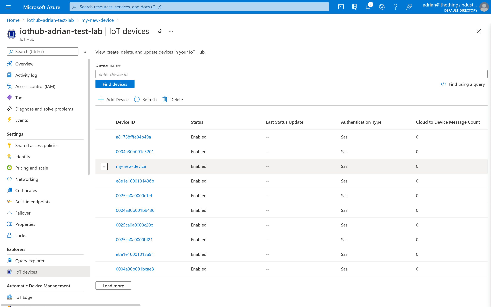

# Managing Devices

> The Azure IoT Hub integration for The Things Stack synchronizes the device registry: you can create devices in Azure IoT Hub which trigger an Azure Function …

Source: https://www.thethingsindustries.com/docs/integrations/cloud-integrations/azure-iot-hub/devices/


The Azure IoT Hub integration for The Things Stack synchronizes the device registry: you can create devices in Azure IoT Hub which trigger an Azure Function that creates the device in The Things Stack.

> **Note:** Devices that you create in The Things Stack are automatically created as Azure IoT Hub devices as soon as they activate or send their first uplink message.
> 
> In Azure IoT Hub, create only devices that are not yet in your The Things Stack application.


## Device Names

Devices are created automatically as they join the network or send an uplink message. For the name of new devices, the end device ID in The Things Stack is used as the device ID in Azure IoT Hub.

## Creating Devices

You can use Azure IoT Hub to create and claim devices in The Things Stack. This is useful to manage all your devices in one place, without having to use The Things Stack Console, CLI or API.

**Creating** a device allows you to add any LoRaWAN® device by manually entering its information and security keys.

In the Azure Console, open your Azure IoT Hub resource. In the menu on the left, click **IoT Devices**.

Click **Add Device**.




As **Device ID**, enter any device ID you like. Hit **Save**.

> **Note:** See [ID and EUI constraints](https://www.thethingsindustries.com/docs/concepts/architecture/id-eui-constraints/) for guidelines about choosing a unique ID.





You will now have to setup the LoRaWAN specific settings of the device. Click on **Device Twin**.




You will now be presented with a JSON document containing the Device Twin. You now have to add a new object called `tags`, which will contain an object called `lorawan` with the LoRaWAN specific tags. You will have to specify the following tags:

- `devEui`: the hexadecimal LoRaWAN DevEUI.
- `joinEui`: the hexadecimal LoRaWAN JoinEUI (or AppEUI).
- `lorawanVersion`: either `1.0`, `1.0.1`, `1.0.2`, `1.0.3` or `1.1`.
- `regionalParametersVersion`: either `1.0`, `1.0.1`, `1.0.2` (or `1.0.2-a`), `1.0.2-b`, `1.0.3-a`, `1.1-a` or `1.1-b`.
- `appKey`: the hexadecimal LoRaWAN AppKey.
- `nwkKey`: the hexadecimal LoRaWAN NwkKey (only when using LoRaWAN 1.1 or higher).
- `frequencyPlanId`: the frequency plan ID. See [Frequency Plans](https://www.thethingsindustries.com/docs/concepts/features/lorawan/frequency-plans/) for the supported values.

If your end device is a part of the [LoRaWAN Device Repository](https://www.thethingsindustries.com/docs/integrations/payload-formatters/device-repo/), you may provide the identifiers of the device as part of an optional `versionIdentifiers` object. You can specify the following information as part of the identifiers:

- `bandId`: the band ID.
- `brandId`: the brand ID.
- `firmwareVersion`: the firmware version.
- `hardwareVersion`: the hardware version.
- `modelId`: the model ID.

> **Note:** If the version identifiers are provided, the end device will automatically load the [Payload Formatters](https://www.thethingsindustries.com/docs/integrations/payload-formatters/) from [LoRaWAN Device Repository](https://www.thethingsindustries.com/docs/integrations/payload-formatters/device-repo/).


The final JSON `tags` object should look as follows:

```json
{
  "lorawan": {
    "devEui": "0004A30B001C5838",
    "joinEui": "800000000000000C",
    "lorawanVersion": "1.0.2",
    "regionalParametersVersion": "1.0.2-b",
    "frequencyPlanId": "EU_863_870_TTN",
    "appKey": "459B77D46A08C427254822A33F6FA1A3",
    "versionIdentifiers": {
      "bandId": "EU_863_870",
      "brandId": "the-things-products",
      "firmwareVersion": "1.0",
      "hardwareVersion": "1.0",
      "modelId": "the-things-node"
    }
  }
}
```




Click on **Save** in the top-left corner. The end device will now be created in The Things Stack.

## Deleting Devices

In the Azure Console, open your Azure IoT Hub resource. In the menu on the left, click **IoT Devices**.

Click on the checkbox in front of the device you want to delete, then click **Delete**.




The end device will be deleted from Azure IoT Hub and The Things Stack.

