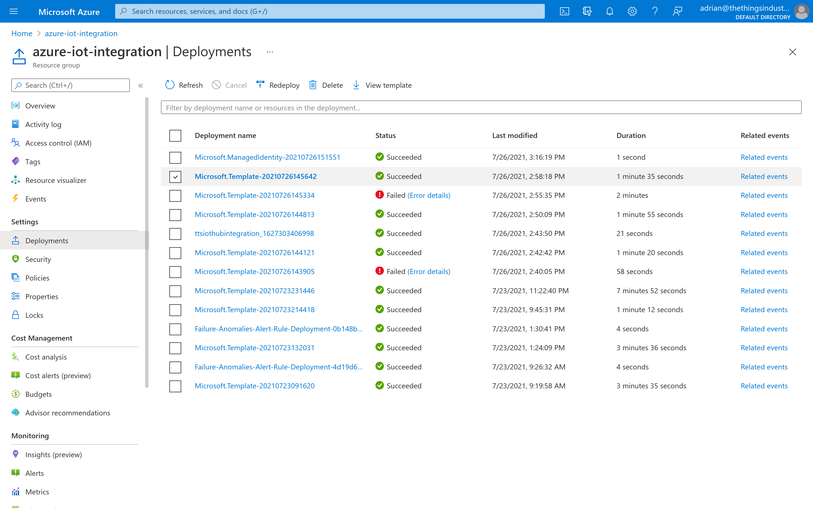
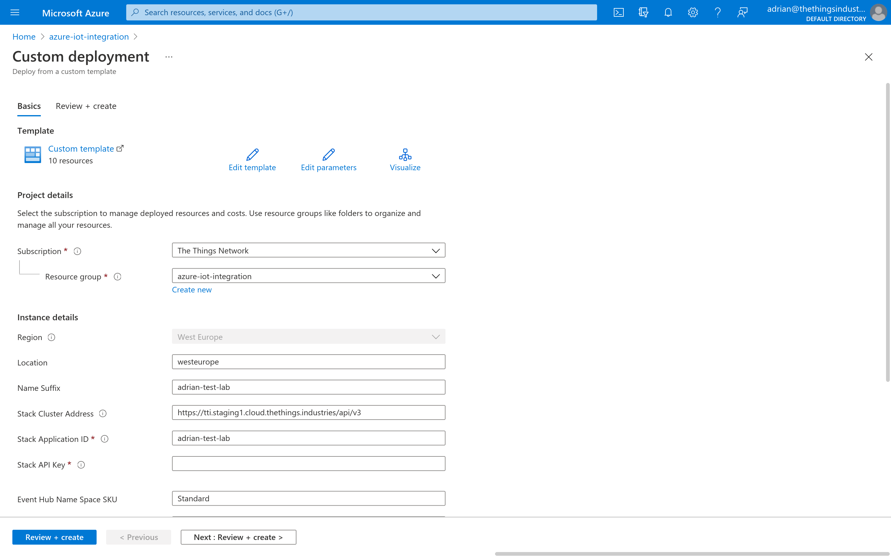
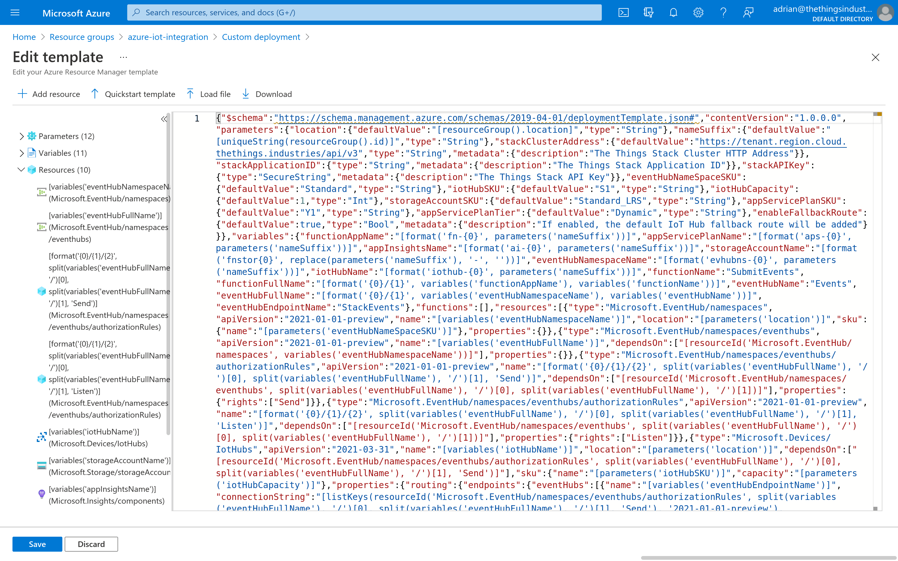

# Update

> You can update the Azure IoT Hub integration for The Things Stack using Azure Resource Manager easily. In most cases, this is without service interruptions.

Source: https://www.thethingsindustries.com/docs/integrations/cloud-integrations/azure-iot-hub/update/

You can update the Azure IoT Hub integration for The Things Stack using [Azure Resource Manager](https://docs.microsoft.com/en-us/azure/azure-resource-manager/management/overview) easily. In most cases, this is without service interruptions.

> Download the latest template from [here](https://ttsiothubintegration.blob.core.windows.net/integration-releases/latest/main.json)

In the Azure Console, open your Resource Group and go to **Deployments**.

In the list of deployments, go to the deployment that you created when deploying the integration. See [Deployment Guide](https://www.thethingsindustries.com/docs/integrations/cloud-integrations/azure-iot-hub/deployment/).

In the top-right, click **Redeploy**.

Click **Edit template**.

Click **Load file** and select the template you have just downloaded.

Click **Save**.

Now, create a new API key as described in the [Deployment Guide](https://www.thethingsindustries.com/docs/integrations/cloud-integrations/azure-iot-hub/deployment/). Provide the created API key for **Stack API Key**.

Review the parameters. Unless new functionality adds new parameters, you can leave the current values unchanged.

Click **Review + Create**, then **Create**.

> **Note:** Updating all resources can take up to 5 minutes.

When the deployment is updated, you'll see the status `Your deployment is complete`.

