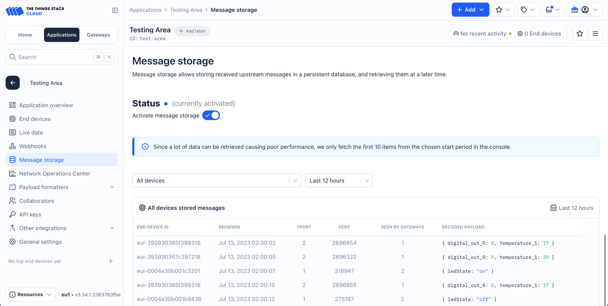

# Storage Integration

> The Storage Integration allows storing received upstream messages in a persistent database, and retrieving them at a later time.

Source: https://www.thethingsindustries.com/docs/integrations/storage/

The Storage Integration allows storing received upstream messages in a persistent database, and retrieving them at a later time.

The Storage Integration is implemented as an Application Package, and can be enabled per application or end device.

## How it works

The Storage Integration runs on the Application Server and watches for upstream traffic (join requests, data uplink messages, data downlink messages, etc). When an upstream message is received from an end device for which the integration has been configured, the message data (Payload, FPort, Decoded Fields, as well as all relevant metadata) are written to a persistent database.

Data retention period is 30 days for The Things Stack Cloud and 24 hours for The Things Stack Sandbox distributions. For The Things Stack Enterprise distributions, data retention period can be [configured](https://www.thethingsindustries.com/docs/integrations/storage/configuration/).

A gRPC service and an HTTP API are exposed so that stored messages can then be retrieved.

> **Note:** The Things Stack Cloud stores only uplink messages.

> **Warning:** The Storage Integration should not be used for querying realtime data. For scalability reasons, writes to the Storage Integration database are performed in batches and there may be a delay after an uplink is received, before it is available. For realtime alerts, use [Webhooks](https://www.thethingsindustries.com/docs/integrations/webhooks/).

---

## Viewing stored messages New in 3.34.1

The Console offers a view for checking the Storage Integration status and displays recently stored messages.

This view allows filtering by end device and time range, and displays stored messages along with decoded payloads and metadata.

> **Note:** For performance reasons, only the first 10 results are shown in the Console.

---

## Downloading messages

The Console allows you to download the **messages currently displayed in the table** view. This provides a quick way to extract and inspect recent stored messages.

Click the **Download** button to download the visible messages in one of the following formats:

- **JSON**: Ideal for programmatic access or integration with other systems.
- **CSV**: Convenient for spreadsheets, quick inspection, or basic analysis.

---

## Typical use cases  

- Long-term storage of historical data for end-devices.
- Reliable message persistence for low-frequency or offline-capable devices.
- No need to maintain a connection with The Things Stack at all times, e.g. for end devices that send messages infrequently.

Detailed instructions about storage integration are in the topics below.

## Pages in this section

- [Configuration](https://www.thethingsindustries.com/docs/integrations/storage/configuration/index.md): This section contains instructions for configuring the Storage Integration on The Things Stack Enterprise distributions. Note: The Storage Integration is …
- [Enable/Disable](https://www.thethingsindustries.com/docs/integrations/storage/enable/index.md): Enable Storage Integration for applications and end-devices.
- [Retrieve Messages](https://www.thethingsindustries.com/docs/integrations/storage/retrieve/index.md): Retrieve historical data using the HTTP API

