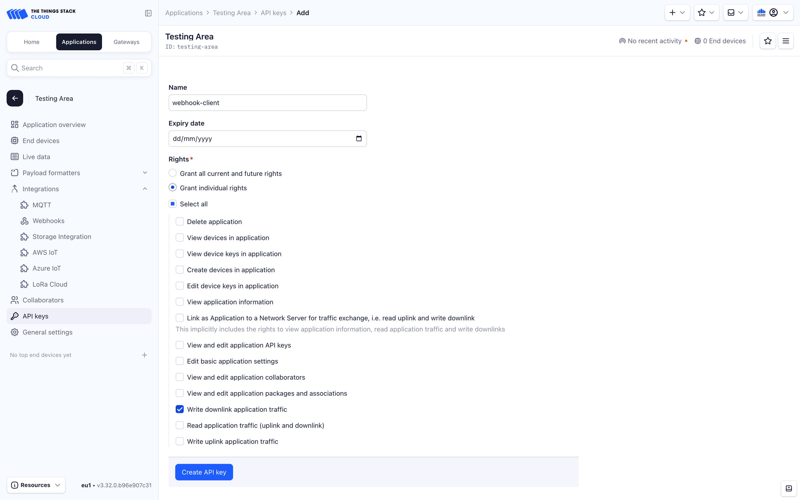
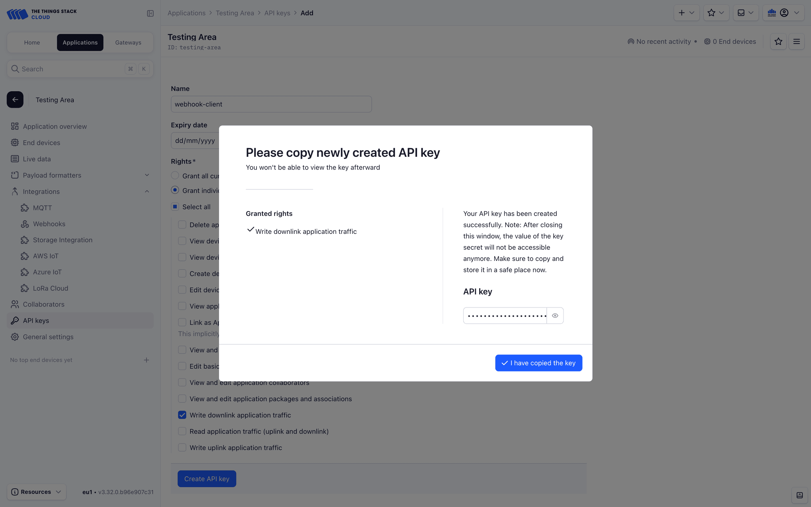

# Scheduling Downlinks

> This section provides instructions for scheduling downlinks using HTTP Webhooks.

Source: https://www.thethingsindustries.com/docs/integrations/webhooks/scheduling-downlinks/


This section provides instructions for scheduling downlinks using HTTP Webhooks.

You can schedule downlink messages using webhooks. This requires an API key with traffic writing rights, which can be created using the Console. 

## Create an API Key

In your application, select **API Keys** on the left menu and click the **+ Add API Key** button. Fill in the **Name** and the **Rights** of your API key.




Click on the **Create API Key** button in order to create the API key. This will open the API key information screen.




> **Note:** Make sure to save your API key at this point, since it will no longer be retrievable after you leave the page.


You can now pass the API key as bearer token on the `Authorization` header.

## Scheduling Downlinks

The downlink queue operation paths are:

- For push: `/api/v3/as/applications/{application_id}/webhooks/{webhook_id}/devices/{device_id}/down/push`
- For replace: `/api/v3/as/applications/{application_id}/webhooks/{webhook_id}/devices/{device_id}/down/replace`

For example, to push a downlink to the end device `dev1` of the application `app1` using the webhook `wh1`:

```bash
curl --location \
  --header 'Authorization: Bearer NNSXS.XXXXXXXXX' \
  --header 'Content-Type: application/json' \
  --header 'User-Agent: my-integration/my-integration-version' \
  --request POST \
  --data '{"downlinks":[{
      "frm_payload":"vu8=",
      "f_port":15,
      "priority":"NORMAL"
    }]
  }' \
  'https://thethings.example.com/api/v3/as/applications/app1/webhooks/wh1/devices/dev1/down/push'
```

To schedule a human readable downlink to the same device using a downlink [Payload Formatter](https://www.thethingsindustries.com/docs/integrations/payload-formatters/):

```bash
curl --location \
  --header 'Authorization: Bearer NNSXS.XXXXXXXXX' \
  --header 'Content-Type: application/json' \
  --header 'User-Agent: my-integration/my-integration-version' \
  --request POST \
  --data '{"downlinks":[{
      "decoded_payload": {
        "bytes": [1, 2, 3]
      }
    }]
  }' \
  'https://thethings.example.com/api/v3/as/applications/app1/webhooks/wh1/devices/dev1/down/push'
```

> **Note:** Downlinks scheduled using the `decoded_payload` Payload Formatter field are encrypted in the Application Server, and the content will not be comprehensible in the Network Server's `frm_payload` field when viewing events.


You can also save the API key in the webhook configuration page using the the **Downlink API Key** field. The Application Server will provide it to your endpoint using the `X-Downlink-Apikey` header and the push and replace operations paths using the `X-Downlink-Push` and `X-Downlink-Replace` headers.

The Things Stack keeps a queue of downlink messages per device. This queue can be replaced with a list of downlink messages. The queue can also be cleared by replacing it with an empty array.

To clear the queue of downlink messages for an end device `dev1` of the application `app1` using the webhook `wh1`:

```bash
curl --location \
  --header 'Authorization: Bearer NNSXS.XXXXXXXXX' \
  --header 'Content-Type: application/json' \
  --header 'User-Agent: my-integration/my-integration-version' \
  --request POST \
  --data '{"downlinks":[]}' \
  'https://thethings.example.com/api/v3/as/applications/app1/webhooks/wh1/devices/dev1/down/replace'
```

