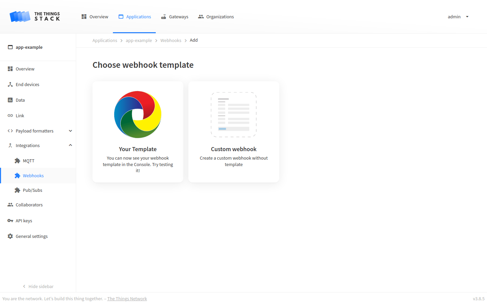

# Adding Webhook Templates

> The Things Stack uses Webhook templates from the lorawan-webhook-templates Github repository. The lorawan-webhook-templates repository is open source, so users …

Source: https://www.thethingsindustries.com/docs/integrations/webhooks/webhook-templates/adding_webhook_templates/


The Things Stack uses Webhook templates from the [`lorawan-webhook-templates` Github repository](https://github.com/TheThingsNetwork/lorawan-webhook-templates/).

The `lorawan-webhook-templates` repository is open source, so users are free to submit pull requests to add new Webhook templates. Naturally, before submitting a new Webhook template in a pull request, one would want to test if the template is correct, i.e. if it yields an integration that is working as expected. A common way to test a newly built Webhook template is to deploy The Things Stack on a local machine (see [installation](https://www.thethingsindustries.com/docs/enterprise/docker/)), while configuring the deployment to use the locally stored Webhook templates.

Once you have created a new Webhook template with a proper [format](https://www.thethingsindustries.com/docs/integrations/webhooks/webhook-templates/format/), follow these steps:

1. Clone the [`lorawan-webhook-templates` Github repository](https://github.com/TheThingsNetwork/lorawan-webhook-templates/) to a local folder (e.g. `/home/webhook-templates`).

2. Store your Webhook template as a YAML file in the previously mentioned folder (e.g. `/home/webhook-templates/my-template.yml`).

3. Include your Webhook template in the pre-existing `templates.yml` file contained in the previously mentioned folder.

4. Include the following lines in [The Things Stack configuration file](https://www.thethingsindustries.com/docs/enterprise/docker/configuration/) (`ttn-lw-stack.yml`):

```yaml
as:
  webhooks:
    templates:
      directory: "/home/webhook-templates" # replace with a path to a local folder where you stored Webhook templates
```

Note that you can skip this step and use `--as.webhooks.templates.directory` command line option when running The Things Stack (step 5) instead.

5. Run The Things Stack.

> **Note:** If you followed the steps above but cannot see your template deployed, make sure that The Things Stack instance you're running is actually using the configuration file mentioned in step 4.


Finally, when The Things Stack is running, go to the Console and select **Webhooks** tab in **Integrations** menu. Click the **Add webhook** button and you will see your newly created template as an integration tile. At this point, you can test your Webhook template.




To make your Webhook template publicly available when the next The Things Stack version is deployed, open a pull request in the [`lorawan-webhook-templates` Github repository](https://github.com/TheThingsNetwork/lorawan-webhook-templates/).

